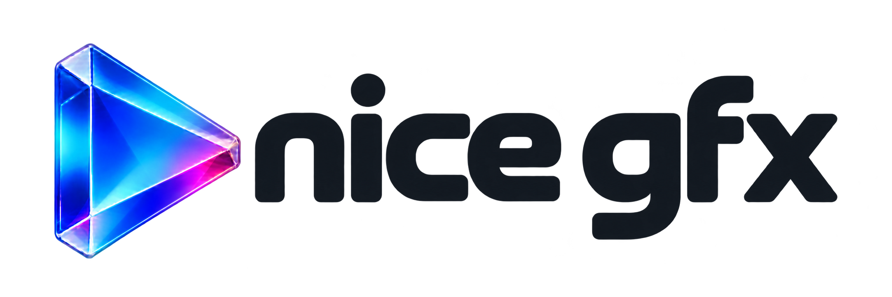

<p align="center">
  
</p>

[English](README.md) | [简体中文](README_ZH.md)

# NICE_GFX

NICE_GFX is an Arduino / ESP-IDF graphics library for color displays, monochrome displays, and e-paper. Display objects receive pins and configuration through their constructors and provide drawing primitives, UTF-8 text, off-screen Sprites, touch input, and partial updates. Selected platforms accelerate transfers with DMA or PIO.

The companion NICE GFX Studio compiles HTML/CSS interfaces into native C++ resources in `ui.h`. The runtime handles components, input, animation, routing, and tiled rendering; application code manages data, callbacks, and hardware operations.

- [Quick start](#quick-start)
- [Displays and platforms](#displays-and-platforms)
- [Fonts and Sprites](#fonts-and-sprites)
- [Designer UIs](#designer-uis)
- [Resource requirements](#resource-requirements)
- [Documentation and examples](#documentation-and-examples)
- [Source layout and checks](#source-layout-and-checks)
- [License and attribution](#license-and-attribution)

## Quick start

### Arduino

1. Place the `NICE_GFX` folder in your Arduino sketchbook's `libraries/` directory and install the Arduino core for your board.
2. Open [Hello_Display](examples/01_Basics/Hello_Display/Hello_Display.ino) from the IDE's Examples menu.
3. Edit the sketch's `Hardware.h` to match your display, pins, rotation, and backlight, then compile and upload.

Next, try [Basic_Shapes](examples/02_Graphics/Basic_Shapes/Basic_Shapes.ino), [Display_Color_Bars](examples/09_Diagnostics/Display_Color_Bars/Display_Color_Bars.ino), and [Sprite_Basics](examples/05_Sprites/Sprite_Basics/Sprite_Basics.ino). The [example guide](examples/README.md) covers wiring and additional dependencies; the [catalog](examples/CATALOG.md) lists the available sketches.

This minimal sketch uses a classic ESP32 and an SPI ILI9341. Adjust the pins for your wiring:

```cpp
#include <NICE_GFX.h>

// CS, DC, RST, SCK, MOSI, MISO
ILI9341_240x320_SPI gfx(5, 2, 4, 18, 23, 19);

void setup() {
  if (!gfx.begin()) return;
  gfx.fillScreen(GFX_BLACK);
  gfx.setFont(nice_gfx::fonts::Fixed6x13);
  gfx.setTextColor(GFX_WHITE, GFX_BLACK);
  gfx.drawString("Hello NICE_GFX", 8, 8);
}

void loop() {}
```

Use `gfx.displayInfo()` to query the controller, dimensions, pins, and bus, and `gfx.lastError()` to inspect initialization or transfer errors. `gfx.asynchronous()` reports the current object's asynchronous transfer capability. On supported backends, `initDMA()` enables asynchronous image submission, `wait()` waits for accepted transfers, and `deInitDMA()` drains and disables that mode.

### ESP-IDF

Add this library under your project's `components/nice_gfx/` directory, or point `EXTRA_COMPONENT_DIRS` at the library directory. Use a C++ source file with an `extern "C" void app_main()` entry point. The [component CMake file](CMakeLists.txt) selects the native ESP32 backend and C++17, using IDF drivers, GPIO, timing, and memory interfaces directly.

The default `full` build profile includes graphics, bundled fonts, and UI. `NICE_GFX_BUILD_PROFILE` also accepts `graphics` and `minimal`; font and UI source selection is configured in the same CMake file.

## Displays and platforms

Choose a preset that matches the controller, resolution, interface, and module wiring:

| Display family | Configuration reference |
| --- | --- |
| Color SPI, software SPI, QSPI, and parallel displays | [Display aliases](src/Display/Presets/DisplayAliases.h) and [controller drivers](src/Drivers/Display) |
| RGB, MIPI, and continuous-scan QSPI displays | [Video aliases](src/Display/Presets/VideoAliases.h) |
| Monochrome displays and u8g2 configurations | [u8g2 presets](src/Display/Presets/U8g2.h) and [display catalog](src/Display/Presets/u8g2-displays.json) |
| Native e-paper | [E-paper presets](src/Display/Presets/NativeEpaper.h) and [Seeed product status](src/Display/Presets/seeed-epaper-displays.json) |
| Integrated boards | [Board presets](src/Display/Presets/BoardPresets.h) |

Touch drivers include XPT2046, CST816, FT6x36, GT911, GT1151, and four-wire resistive input. See the [touch drivers](src/Drivers/Touch), [capacitive touch example](examples/06_Touch/Vendor_Capacitive_Touch/Vendor_Capacitive_Touch.ino), and [XPT2046 calibration example](examples/06_Touch/Touch_calibrate/Touch_calibrate.ino).

| Platform | Available backends |
| --- | --- |
| ESP32 family | SPI / QSPI, software SPI, GPIO parallel, and DMA where supported; RGB, MIPI, and scanout depend on the target's peripherals |
| ESP8266 | Core SPI, software SPI, and GPIO parallel with synchronous transfers |
| STM32 | Core SPI, software SPI, GPIO parallel, and DMA on selected families and SPI instances |
| RP2040 / RP2350 with Arduino-Pico | PIO SPI, native SPI DMA, PIO/GPIO parallel, and software SPI |
| RP2040 with Arduino mbed | Core SPI, software SPI, and GPIO parallel with synchronous transfers |
| AVR, SAMD, and Renesas | Arduino SPI / GPIO paths, subject to the core, available pins, and memory |
| CI13XX / CI130X | I2C, core software SPI, and GPIO parallel; see the [platform notes](src/Platform/CI13XX/README.md) |
| Other Arduino cores | Generic SPI / GPIO paths; compile and validate for the chosen core |

Display power, timing, color order, and pins must match the actual module. For e-paper, check protocol implementation and hardware validation status in the product catalog. The [refresh example](examples/09_Diagnostics/EpaperRefresh/README.md) shows how to advance refreshes with `pollDisplay()`; transfer completion through `wait()` does not imply that the panel's optical refresh has finished.

## Fonts and Sprites

Built-in fonts include bitmap, grayscale, Chinese, Latin, and specialized numeric faces. Fonts exposed by the main header are listed in the [font declarations](src/Fonts/Builtin.h); see the [font guide](src/Fonts/README.md) and [text examples](examples/03_Text/README.md) for usage.

Select fonts independently for the display and each Sprite with `setFont()`. Text uses UTF-8, and `setTextSize(1..7)` applies integer scaling. No font is selected by default. Unreferenced font data can be removed by the linker; Chinese subsets help reduce Flash usage.

`GFX_Sprite` provides 1/4/8/16-bit off-screen canvases. With `gfx` already initialized:

```cpp
GFX_Sprite sprite(&gfx);
sprite.setColorDepth(16);
if (sprite.createSprite(120, 48)) {
  sprite.fillSprite(GFX_BLACK);
  sprite.setFont(nice_gfx::fonts::Fixed6x13);
  sprite.setTextColor(GFX_WHITE, GFX_BLACK);
  sprite.drawString("Ready", 4, 4);
  sprite.pushSprite(8, 8);
  gfx.wait();
}
```

Check allocation results and budget memory for the canvas dimensions and color depth. See [Graphics/Sprite.h](src/Graphics/Sprite.h) for the interface.

## Designer UIs

NICE GFX Studio exports pages, components, themes, routing, and hardware configuration. The generated `ui.h` runs in a native `nice_gfx::htmlui::View`.

1. Configure the display, resolution, rotation, and touch or physical buttons in the designer.
2. Create pages and components, give application-accessed elements stable IDs, and declare event actions.
3. Export a complete project and add application state and callbacks.
4. Call the generated `pollUi()` continuously and update the active page with methods such as `setText()`, `setValue()`, and `setImage()`.

The runtime supports buttons, sliders, input fields, an automatic keyboard, gauges, charts, images, scrolling, focus, navigation, and animations. Touch and physical keys use the same event system. Application code retains business data across page changes.

Keep generated resources, adapters, and the runtime compatible. The resource version is defined by `ResourceVersion` in [UI/Compiled.h](src/UI/Compiled.h) and checked by generated headers. See [GfxTouchDemo](examples/07_UI/GfxTouchDemo/README.md) for a complete integration and the [UI runtime guide](src/UI/README.md) for rendering, input, ownership, and motion APIs.

## Resource requirements

| Resource | Usage guidance |
| --- | --- |
| Native designer UI | Requires a complete C++ standard library and enough dynamic memory; use basic drawing interfaces on AVR |
| RGB565 framebuffer | Pixel storage is width × height × 2 bytes; double buffering doubles this storage |
| Sprites, images, and caches | Check allocations and allow for old images and in-flight frames to coexist during updates |
| Asynchronous transfers | Retain buffers for the lifetime required by the interface and wait before reusing them |
| Multitasking | Serialize access to a shared display object and View; `startWrite()/endWrite()` group drawing operations |
| UI scheduling | Keep processing input and `tick()/pollUi()`; move lengthy work to a state machine or background task |
| External resources | Install the decoding, storage, network, and sensor dependencies used by the chosen example |

UI rendering uses tiles and configurable caches. Use `runtimeStats()`, `memoryStats()`, and actual transfer measurements to assess a page's memory and refresh budget.

## Documentation and examples

| Reference | Contents |
| --- | --- |
| [Example guide](examples/README.md) and [catalog](examples/CATALOG.md) | Sketch selection, wiring, and dependencies |
| [Font guide](src/Fonts/README.md) | Font selection, coverage, and subsets |
| [UI runtime](src/UI/README.md) | Resources, rendering, input, navigation, and animation |
| [GfxTouchDemo](examples/07_UI/GfxTouchDemo/README.md) | Designer project, generated resources, and event callbacks |
| [DynamicImageDemo](examples/07_UI/DynamicImageDemo/README.md) | Runtime image updates and ownership |
| [MonochromeMenu](examples/07_UI/MonochromeMenu/README.md) | Monochrome drawing and key-driven menus |
| [EpaperRefresh](examples/09_Diagnostics/EpaperRefresh/README.md) | E-paper initialization and refresh scheduling |
| [Waveshare4B](examples/07_UI/Waveshare4B/README.md) | ST7701, GT911, and TCA9554 board configuration |
| [WioFieldLab](examples/08_Applications/WioFieldLab/README.md) | Wio Terminal sensors, SD, infrared, and Wi-Fi application |
| [MosaicoCameraDemo](examples/08_Applications/MosaicoCameraDemo/README.md) | ESP-Mosaico live camera preview and overlays |
| [Graphics_Benchmark](examples/10_Performance/Graphics_Benchmark/README.md) | Drawing and transfer benchmarks |

## Source layout and checks

| Path | Responsibility |
| --- | --- |
| `src/NICE_GFX.h` | Convenience entry point for graphics, Sprites, fonts, touch, and display presets |
| `src/Core/`, `src/Graphics/` | Shared types, drawing, text, Sprites, and tiled canvases |
| `src/Display/` | Display objects, panels, transfer and refresh abstractions, and presets |
| `src/Drivers/` | Display and touch controller implementations |
| `src/Platform/` | Arduino and target-specific bus implementations |
| `src/Fonts/` | Font declarations, decoding, glyph data, and licenses |
| `src/UI/` | Compiled resources, View, components, input, routing, and rendering |
| `examples/`, `tests/` | Arduino sketches and host checks |

Arduino sketches should include `<NICE_GFX.h>` before generated headers so the build tools can discover the installed library. C++ and ESP-IDF projects can include module headers such as `<Graphics/Gfx.h>`, `<Graphics/Sprite.h>`, `<Fonts/Builtin.h>`, and `<UI/View.h>` directly.

Run the native e-paper host checks from the library root:

```powershell
npm run test:epaper
```

The [test guide](tests/epaper/README.md) describes Node.js and compiler requirements, protocol coverage, and test output. Validate colors, coordinates, input, and sustained refreshes on the actual hardware.

## License and attribution

Original NICE_GFX code is licensed under the [Apache License 2.0](LICENSE). It is free to use, modify and distribute in commercial and noncommercial projects, including closed-source applications, subject to that license. No library royalty or NICE GFX Studio subscription is required.

When redistributing covered source, firmware or derived works, provide the license, preserve applicable copyright and modification notices, and reproduce relevant [NOTICE](NOTICE) attributions as required by Apache-2.0 section 4. They can be supplied in an accompanying NOTICE file, source/documentation, or an appropriate legal-notices display as the license permits. We appreciate a public acknowledgment such as **“This product uses the nice gfx graphics library”** with a [project link](https://github.com/ailyProject/nice-gfx); website promotion, chip-vendor first recommendation and separate commercial approval are not license conditions.

NICE GFX Studio and its AI design services are separately licensed commercial products. Paying for the designer is not a condition of using this runtime. Exported applications can continue to run and be commercially distributed after a designer subscription ends; any copied runtime, fonts, icons and other third-party materials retain their respective licenses.

Bundled third-party code and assets are not relicensed by the top-level Apache grant. See [third-party notices](THIRD_PARTY_NOTICES.md), the [license index](LICENSES/README.md), [font licenses](src/Fonts/licenses), [icon license](src/Graphics/LICENSE-Font-Awesome.txt), and [graphics license](src/Graphics/LICENSE-Bodmer.txt). Some legacy examples and images have separate or unconfirmed permissions, as identified in the third-party notices; the Apache grant does not resolve those rights.
