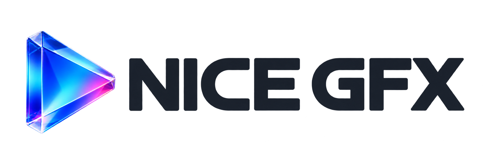

<p align="center">
  
</p>

NICE_GFX is an Arduino / ESP-IDF graphics library for color displays, monochrome displays, and e-paper. It also supports all public physical-display configurations from a pinned version of u8g2. Display objects receive pins and configuration through their constructors and provide drawing primitives, UTF-8 text, off-screen Sprites, touch input, and partial updates. Selected platforms use DMA or PIO to accelerate transfers. Native ESP-IDF integration uses IDF drivers, GPIO, timing, and memory interfaces directly, without an Arduino component.

The companion designer compiles application interfaces into native C++ resources in `ui.h`. The runtime handles component state, input, animation, routing, and tiled rendering; application code manages business data, event callbacks, and hardware operations.

- [Quick start](#quick-start)
- [Display and touch device support](docs/DeviceSupport.md)
- [Monochrome displays, e-paper, and menu updates](docs/MonochromeAndEpaper.md)
- [Full u8g2 catalog compatibility, wiring, and performance](docs/U8g2Compatibility.md)
- [E-paper controllers, library comparisons, and multicolor panels](docs/EpaperCompatibility.md)
- [Waveshare ESP32-S3-Touch-LCD-4B: ST7701, GT911, and TCA9554 board configuration](examples/07_UI/Waveshare4B/README.md)
- [Platform support](#platform-support)
- [Fonts and Sprites](#fonts-and-sprites)
- [Designer UIs and device interaction](#designer-uis-and-device-interaction)
- [Features and resource limits](#features-and-resource-limits)
- [Documentation and examples](#documentation-and-examples)
- [Source layout and checks](#source-layout-and-checks)

## Quick start

Examples are organized by feature and learning order; see the [example catalog](examples/README.md) for the full list. Start with [Hello_Display](examples/01_Basics/Hello_Display/Hello_Display.ino), then try [Basic_Shapes](examples/02_Graphics/Basic_Shapes/Basic_Shapes.ino), [Sprite_Basics](examples/05_Sprites/Sprite_Basics/Sprite_Basics.ino), and [Display_Color_Bars](examples/09_Diagnostics/Display_Color_Bars/Display_Color_Bars.ino). These examples calculate their layouts from the display's current width and height. Configure wiring, rotation, and backlight in the sketch's `Hardware.h`. Wio Terminal uses the same entry points, with its template selecting onboard SPI3, rotation 3, and `LCD_BACKLIGHT`. The complete [Wio Field Lab](examples/08_Applications/WioFieldLab/README.md) includes sensor, SD, infrared, and asynchronous Wi-Fi applications, plus a project you can import into the editor.

Place the `NICE_GFX` folder in the `libraries/` folder of your Arduino sketchbook, install the Arduino core for your board, and open a library example from the IDE's Examples menu. See [examples/README.md](examples/README.md) for wiring and additional dependencies.

The following example uses a classic ESP32 and an ILI9341 connected over SPI. The pins must match your wiring. See [device support](docs/DeviceSupport.md) for other displays and touch controllers.

```cpp
#include <NICE_GFX.h>

// CS, DC, RST, SCK, MOSI, MISO
ILI9341_240x320_SPI gfx(5, 2, 4, 18, 23, 19);

void setup() {
  if (!gfx.begin()) return;
  gfx.fillScreen(GFX_BLACK);
  gfx.setFont(nice_gfx::fonts::Fixed6x13);
  gfx.setTextColor(GFX_WHITE, GFX_BLACK);
  gfx.drawString("Hello NICE_GFX", 8, 8);
}
void loop() {}
```

Use `gfx.displayInfo()` to query the controller, dimensions, pins, and bus; `gfx.lastError()` to inspect initialization or transfer errors; and `gfx.asynchronous()` to query the current display object's asynchronous transfer capabilities.

Initialize displays with `begin()` or `beginChecked()`. Use `pushBlock(color, pixelCount)` for a repeated color, `pushPixels(data, pixelCount)` for pixel arrays, and `startWrite()/endWrite()` to group writes. The length passed to `pushPixels` is always a pixel count. Use `setSwapBytes(true)` for host RGB565 arrays and `setSwapBytes(false)` for MSB-first byte arrays. The display object's forwarding entry points `init()`, two-argument `pushColor()`, `pushColors()`, and two-argument `writeColor()` have been removed. Sprite's `pushColor(color, pixelCount)` is a separate canvas implementation and remains available.

`initDMA()` takes no chip-select argument; chip select and transfer settings are selected through the constructor. `asynchronous()` queries capabilities, `initDMA()` enables supported asynchronous image submission, `deInitDMA()` drains pending transfers and disables that mode, and `wait()` waits for accepted transfers to complete.

ESP-IDF projects integrate the library as a native component and use a C++ `app_main()`. The separate sibling [nice_gfx_idf_examples 1.0.0 example package](../nice_gfx_idf_examples/README.md) provides 34 projects covering drawing, fonts, Sprite/DMA, UI, and IDF tasks, timers, GPIO, NVS, and event loops.

## Display controllers and instantiation

[Display and touch device support](docs/DeviceSupport.md) is the central reference for display controllers, interfaces, default resolutions, and instantiation methods. It covers SPI, software SPI, 8/16-bit parallel buses, standard QSPI, RGB, MIPI, and ST77903 continuous-scan QSPI.

Touch implementations include XPT2046, I²C controllers such as CST816 / FT6x36 / GT911 / GT1151, and four-wire resistive panels. See [touch integration](docs/DeviceSupport.md#触摸芯片与使用入口) for driver entry points, board combinations, and calibration, and [Vendor_Capacitive_Touch](examples/06_Touch/Vendor_Capacitive_Touch/Vendor_Capacitive_Touch.ino) for a wiring example. Display resolution, interface, power, and timing must match the actual module.

## Platform support

The table below describes the backends provided by the current source. Available display interfaces also depend on the target chip's peripherals, Arduino core, available pins, and memory. Compile your own project for the chosen target and validate it on the actual display.

| Platform | Display buses and acceleration | Main constraints |
| --- | --- | --- |
| ESP32 family | SPI / QSPI, software SPI, GPIO 8/16-bit parallel; DMA where supported by the backend | RGB requires an LCD RGB peripheral; MIPI uses ESP32-P4; ST77903 scanning requires an SPI SCT peripheral |
| ESP8266 | Core SPI, software SPI, GPIO parallel | Synchronous transfers; hardware SPI pins are constrained by the core |
| STM32 | Core SPI, software SPI, GPIO parallel; DMA on selected families and SPI instances | Current DMA mappings cover F0/F1/F2/F3/F4/F7/G0/G4/L0/L1/L4; H7/U5 use the synchronous path |
| RP2040 / RP2350, Arduino-Pico core | PIO SPI, native SPI DMA, PIO/GPIO parallel, software SPI | PIO and DMA resources are limited; parallel transfers fall back to GPIO when data-pin continuity or GPIO window requirements are not met |
| RP2040, Arduino mbed core | Core SPI, software SPI, GPIO parallel | Uses mbed SPI mappings and the synchronous path |
| AVR ATmega328P / ATmega2560 | Core SPI, software SPI, GPIO parallel, optimized direct PORT writes | Limited RAM, Flash, and pin count; use basic drawing, short text, and small Sprites within available capacity |
| SAMD / Renesas | Core SPI, software SPI, GPIO parallel | Generic synchronous path; confirm capabilities for the specific core and board |
| CI13XX | Core SPI, software SPI, GPIO parallel | The CI1302 core's SPI interface uses a software implementation |
| Other Arduino cores | Generic Arduino SPI / GPIO path | Requires compatible GPIO, SPI, Print, and timing interfaces, plus separate compilation validation |

DMA capabilities and resource allocation depend on the actual object; query them with `gfx.asynchronous()`. See [Stm32Spi.h](src/Platform/STM32/Stm32Spi.h) for STM32 mappings and fallback logic, and [Rp2040Spi.h](src/Platform/RP2040/Rp2040Spi.h) and [Rp2040Pio.h](src/Platform/RP2040/Rp2040Pio.h) for the RP2040/RP2350 backends.

## Fonts and Sprites

The library includes 22 monospaced bitmap fonts: 13 English and 9 Chinese. Select fonts independently for the display and each Sprite with `setFont()`. `setTextSize(1..7)` scales pixels by an integer factor. No font is selected by default; unreferenced font data can be removed by the linker.

`drawString()`, `drawNumber()`, `drawFloat()`, and `print()/println()` use the current font, with strings encoded as UTF-8. Full Chinese fonts require substantial Flash. On AVR, use subsets for short text and check the PROGMEM address range. See the [font guide](docs/font.md) and [font maintenance notes](src/Fonts/README.md) for glyph previews, character coverage, fallback fonts, and subset generation.

`GFX_Sprite` provides 1/4/8/16-bit off-screen canvases. The following snippet assumes that the display object `gfx` has already been initialized:

```cpp
GFX_Sprite sprite(&gfx);
sprite.setColorDepth(16);
if (sprite.createSprite(120, 48)) {
  sprite.fillSprite(GFX_BLACK);
  sprite.setFont(nice_gfx::fonts::Fixed6x13);
  sprite.setTextColor(GFX_WHITE, GFX_BLACK);
  sprite.drawString("Ready", 4, 4);
  sprite.pushSprite(8, 8);
  gfx.wait();
}
```

Check the return value when creating a canvas. Buffer usage grows with dimensions and color depth. See [Graphics/Sprite.h](src/Graphics/Sprite.h) for the interface.

## Designer UIs and device interaction

The companion [NICE GFX Studio](../nice_gfx_editor/README.md) provides pages, components, themes, routing, and hardware configuration. HTML/CSS is compiled into `ui.h` at export time, and the device runs a native `nice_gfx::htmlui::View`.

1. Select the display, resolution, rotation, touch input or physical buttons in the designer, and verify the actual pins.
2. Create pages and components, assign stable IDs to elements accessed by application code, and declare event actions.
3. Export a complete Arduino project initially, then add application state and callbacks to the main program.
4. Call the generated `pollUi()` continuously and update the current page through interfaces such as `setText/setValue/setImage`.

```cpp
#include "Hardware.h"
#include "ui.h"
#include "TouchAdapter.h"

nice_gfx::htmlui::View ui(displayInstance(), kTilePixels);
bool uiReady = false;

void setup() {
  if (!beginDisplayHardware()) return;
  uiReady = ui_config::load(ui) == nice_gfx::Status::Ok;
  // Bind application callbacks using the bind_* interfaces generated in ui.h.
}
void loop() {
  if (uiReady) pollUi(ui, millis());
}
```

The runtime provides buttons, switches, sliders, input fields, gauges, charts, images, scrolling, pagination, focus, and routing. Touch and physical buttons feed into the same event system. Application code retains the data and updates the UI by page and changed item. See the [dynamic image guide](docs/DynamicImages.md) for image copying, ownership transfer, and switching to preset resources.

Input fields and numeric steppers share an automatic keyboard. It is full-screen by default, supports a configurable height and light/dark themes, and allows cursor movement by tapping or swiping left/right across the content, plus backspace deletion. The designer stores the field's theme through `data-keyboard-theme="light|dark"`. In firmware, use `ui.setKeyboardTheme(nice_gfx::htmlui::KeyboardTheme::Dark)` for dark mode or pass `KeyboardTheme::Light` for light mode. `ui.resetKeyboardTheme()` restores the field configuration, and `ui.keyboardTheme()` queries the effective theme. The keyboard's top bar contains only collapse and password visibility controls. See the [compiler documentation](../nice_gfx_editor/packages/html-ui/README.md#原生输入-api) for input and submission APIs.

The current resource ABI is 17. Compatibility is determined by [UI/Compiled.h](src/UI/Compiled.h) and the assertions in generated `ui.h`. When upgrading, re-export the complete project and synchronize the runtime and generated adapters while retaining your existing application main program. Motion supports a limited set of multi-property keyframes, staggering, alternating playback, visibility and completion events, local scaling/rotation of images and icons, and subtree reveals. See the [native motion API](src/UI/README.md#compiled-keyframes-and-local-transforms-abi-17-motion-api-1). For component APIs, callback semantics, and navigation rules, see [Arduino component interaction](docs/ArduinoComponentInteraction.md); for HTML/CSS syntax, see [compiler support](../nice_gfx_editor/packages/html-ui/HTML_CSS_SUPPORT.md).

## Features and resource limits

| Feature | Requirements |
| --- | --- |
| Native designer UI | Requires a complete C++ standard library and sufficient dynamic memory; AVR currently uses only the basic display drawing interfaces |
| RGB565 framebuffer | Pixel memory is width × height × 2 bytes, doubled for double buffering; configure within the internal RAM / PSRAM budget |
| Sprites, images, and caches | Check allocation results; old images being replaced and in-flight frames may briefly occupy memory at the same time |
| Asynchronous transfers | Retain input buffers as required by the interface and wait for `wait()` to complete before reusing them; copy completion does not imply physical VSYNC |
| Multitasking access | The application must serialize access to the same display object and View; `startWrite()/endWrite()` group drawing operations |
| UI scheduling | Keep processing input and calling `tick()/pollUi()`; event callbacks should record work requests, with time-consuming operations handled by state machines or background tasks |
| Images and external resources | PNG/JPEG decoding, storage, networking, and sensors are handled by the application or corresponding dependencies |
| Modules and SDKs | Configure power, GPIO, video timing, color order, and readback wiring for the actual hardware; rebuild and validate after SDK upgrades |

The native UI uses tiled rendering and configurable caches. Refresh throughput depends on region size, bus, memory, and page complexity. Evaluate resource budgets using `runtimeStats()`, `memoryStats()`, and measurements of actual display transfers.

## Documentation and examples

| Document or example | Contents |
| --- | --- |
| [Device support](docs/DeviceSupport.md) | Display and touch controllers, interfaces, resolutions, instantiation, and initialization constraints |
| [Font guide](docs/font.md) | Previews of all fonts, coverage, usage, and Chinese subsets |
| [Arduino component interaction](docs/ArduinoComponentInteraction.md) | Stable IDs, events, values and input, navigation, application integration, and scheduling |
| [Dynamic images](docs/DynamicImages.md) | Runtime pixel updates, ownership, preset resources, and memory contracts |
| [UI runtime](src/UI/README.md) | Resource lifecycles, rendering, input, routing, and animation |
| [ESP-IDF example package](../nice_gfx_idf_examples/README.md) | 34 native IDF projects, including performance benchmarks using scenarios shared with Arduino |
| [Example catalog](examples/README.md) | Wiring, fonts, touch, and additional dependencies |
| [GfxTouchDemo](examples/07_UI/GfxTouchDemo/README.md) | Editable designer project, generated resources, application state, and event callbacks |
| [DynamicImageDemo](examples/07_UI/DynamicImageDemo/README.md) | Complete Arduino example for dynamic images |
| [MosaicoCameraDemo](examples/08_Applications/MosaicoCameraDemo/README.md) | ESP-Mosaico V1.2 live camera preview, color recognition, and detection-box overlays |
| [Display_Info](examples/09_Diagnostics/Display_Info) | Querying the actual display object and bus capabilities |
| [Touch_calibrate](examples/06_Touch/Touch_calibrate/Touch_calibrate.ino) | XPT2046 wiring and calibration |

## Source layout and checks

| Path | Responsibility |
| --- | --- |
| `src/NICE_GFX.h` | Convenience entry point for drawing, Sprites, built-in fonts, and display presets |
| `src/Core/` | Status, pixels, geometry, and shared algorithm utilities |
| `src/Graphics/` | Drawing, text, Sprites, and TileCanvas; `Gfx.h` is the lighter entry point for drawing declarations |
| `src/Display/` | Display objects, shared Panel, transfer abstractions, and refresh; `Presets/` stores size, interface, and module presets |
| `src/Drivers/Display/`, `src/Drivers/Touch/` | Controller programs and concrete drivers; each display controller's initialization, rotation, and class definition are maintained in the same file |
| `src/Platform/` | Generic Arduino buses and separate ESP32, STM32, and RP2040 platform implementations |
| `src/Fonts/` | Font declarations, decoding, and 26 separate glyph-data compilation units |
| `src/UI/` | Resource structures, View, components, input, navigation, and rendering support |
| `docs/`, `examples/` | Usage documentation and Arduino examples; IDF examples are in the sibling `../nice_gfx_idf_examples/` directory |

The designer application and HTML/CSS compiler live in the separate `nice_gfx_editor/` repository. Maintenance scripts for the main library are in `tools/`, and host tests are in `tests/`. Device firmware uses the main library source and generated resources. See the [architecture guide](docs/Architecture.md) for directory responsibilities, compatibility entry points, board configuration, and build methods.

To change controller programs or address-window alignment, edit the corresponding files in `src/Drivers/Display/`. To change display combinations and type aliases, edit `src/Display/`. Arduino and ESP-IDF share the graphics, font, and UI source. Native IDF selects the ESP32 platform source files and excludes the Arduino, RP2040, and STM32 platform implementations. Maintenance tools update the display catalog and capability tables.

Arduino sketches should include `<NICE_GFX.h>` first so the build tools can discover the installed library. Designer resources include `<UI/View.h>` and declarations for the fonts they use. Module headers are public interfaces: `<Graphics/Gfx.h>` declares drawing objects, `<Graphics/Sprite.h>` declares Sprites, `<Fonts/Builtin.h>` declares built-in fonts, and `<Display/Presets/All.h>` provides display presets. Standard C++ and ESP-IDF projects can combine module headers as needed; graphics and UI declarations do not pull in concrete display controllers or MCU backends.

Run the following commands from the library root to check release metadata, documentation links, example configuration, and module dependencies:

```powershell
npm run check
# Requires a C++17 compiler and CMake on PATH, or set CXX / CMAKE:
npm test
# Synchronize version numbers, resource ABI notes, and motion links, then check again:
npm run metadata:sync
```

Host regression tests use fixed resources within the library and do not depend on the designer repository. The same test entry point covers frame lifecycles, native/tiled rendering comparisons, and memory allocation failures. See [host tests](tests/README.md) for configuration.

Validate colors, coordinates, input, the first frame, and sustained operation in your actual project.

For licenses and notices covering fonts, icons, and bundled code, see the [font license directory](src/Fonts/licenses), [icon license](src/Graphics/LICENSE-Font-Awesome.txt), [graphics license](src/Graphics/LICENSE-Bodmer.txt), and [other license files](LICENSES).
