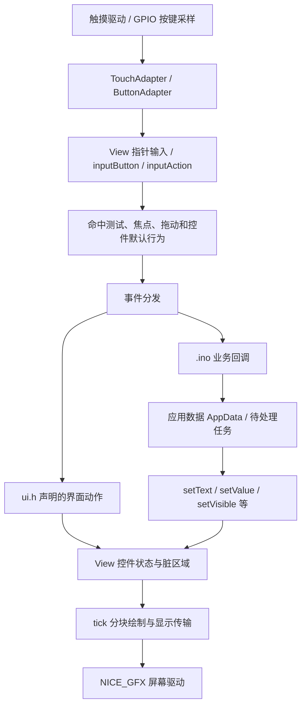

# Arduino 组件交互与联动

本文适用于 NICE_GFX / 设计器 / HTML UI 编译器 1.0.0，原生资源 ABI 15。资源格式以 [UI/Compiled.h](../src/UI/Compiled.h) 的 `ResourceVersion` 和实际导出的 `ui.h` 断言为准。

本文所说的“组件”主要是 `nice_gfx_editor` 的可用组件：当前目录包含 23 项基础组件和 10 项封装组件。所有界面均由设计器工程生成，Arduino 代码负责业务数据、事件和硬件。

在 Arduino 中，设计器组件的交互由 `nice_gfx::htmlui::View` 处理。触摸或实体按键进入 View，View 修改控件状态、发出事件，业务回调更新应用数据，再通过 setter 更新其他组件。组件之间的简单显示联动也可以在设计器中声明，随 `ui.h` 一起导出。

全部组件接口见第 6、7 节，业务状态和刷新调度见第 15 节。组合组件由 `ui_config::load()` 安装只读链接，需要具备 `NICE_GFX_UI_COMPONENTS_VERSION >= 1` 的运行库。更新旧工程时同步 `ui.h` 和配套运行库。

## 目录

1. [设计器组件与设备运行接口](#1-设计器组件与设备运行接口)
2. [导出文件与运行链路](#2-导出文件与运行链路)
3. [完整 Arduino 接入示例](#3-完整-arduino-接入示例)
4. [ID、事件绑定与回调参数](#4-id事件绑定与回调参数)
5. [事件时机、传播与取消](#5-事件时机传播与取消)
6. [全部基础组件的交互表](#6-全部基础组件的交互表)
7. [十种封装组件的交互表](#7-十种封装组件的交互表)
8. [组件之间的声明式联动](#8-组件之间的声明式联动)
9. [按钮、开关、滑块的业务联动](#9-按钮开关滑块的业务联动)
10. [文字与数值输入、自动键盘](#10-文字与数值输入自动键盘)
11. [仪表、环形进度与图表更新](#11-仪表环形进度与图表更新)
12. [滚动、子分页与页面路由](#12-滚动子分页与页面路由)
13. [实体按键与焦点导航](#13-实体按键与焦点导航)
14. [显隐、禁用、动画、样式与布局](#14-显隐禁用动画样式与布局)
15. [业务数据、刷新调度与生命周期](#15-业务数据刷新调度与生命周期)
16. [常见问题与排查](#16-常见问题与排查)
17. [源码与现有示例](#17-源码与现有示例)

## 1. 设计器组件与设备运行接口

设计器工程中的 HTML/CSS 编译为 `ui.h`，由 `UI/View.h` 的 `nice_gfx::htmlui::View` 加载。生成资源显式包含字体声明，`Hardware.h` 单独包含显示预设。View 管理页面与控件状态，通过事件回调、声明式动作和 setter 更新界面；运行循环持续采样输入并调用 `tick(millis())`。

显示驱动 `NICE_GFX` 负责底层绘制和传输。业务代码负责传感器、GPIO、通信和设置保存，并通过生成的 ID 与事件绑定接口连接界面。UI 回调不会自动操作硬件。

## 2. 导出文件与运行链路

### 2.1 文件职责

| 文件 | 内容与使用方式 |
| --- | --- |
| `ui.h` | 不可变的页面资源、样式、初值、路由、界面动作和业务绑定入口；设计器生成 |
| `项目名.ino` | 应用数据、回调实现、后台工作、setup/loop；由开发者维护 |
| `Hardware.h` | 屏幕实例 `gfx`、引脚、旋转、UI 尺寸、`kTilePixels` 等 |
| `TouchAdapter.h` | `beginDisplayHardware()`、触摸采样、取消接触、`pollUi()` 调度 |
| `ButtonAdapter.h` | 配置实体按键时生成，负责 GPIO 采样、消抖及向 View 发送按键 |
| `src/nice_gfx/` | 完整 Arduino ZIP 内附的运行库；使用已安装库时可以采用对应的库头文件 |
| `data/` 中的工程与页面源码 | 用于继续编辑、重建界面；设备不在运行时解析这些 HTML/CSS |

首次建议导出完整 Arduino 项目，配置并核对实际硬件。后续仅改变界面并保持接口、硬件和 ABI 兼容时，可只替换 `ui.h`。不要用重新导出的起步 `.ino` 覆盖已有业务程序。

主程序按下列顺序包含文件，使 `Hardware.h` 中的 `NICE_GFX_UI_HEADER` 能选择完整导出项目内附的运行库。使用已安装的 Arduino 库时，先加 `#include <NICE_GFX.h>` 让构建工具发现库：

```cpp
#include "Hardware.h"
#include "ui.h"
#include "TouchAdapter.h"
```

### 2.2 运行链路



“有事件绑定”和“有画面刷新”是两件事：绑定成功后仍要持续调用 `pollUi()` 或自行调用 `tick()`，触摸、动画、惯性、分页吸附和像素传输才会继续运行。

## 3. 完整 Arduino 接入示例

以下示例使用基础原生控件，方便业务代码按稳定 ID 读写。先在设计器中建立 480×480 工程，创建 `/` 与 `/settings` 两个路由，将对应 HTML 放到各页，再按实际屏幕导出完整 Arduino 项目。

### 3.1 首页 `/`

```html
<main id="home" style="width:100%;height:100%;padding:16px;gap:8px">
  <p id="title">设备控制</p>
  <p id="status">待保存</p>
  <p id="reading">60 %</p>
  <input id="brightness" type="range" min="0" max="100" step="1" value="60"
    data-on-input="brightnessInput" data-on-change="brightnessCommitted">
  <gfx-switch id="enabled" checked data-on-change="enabledChanged"></gfx-switch>
  <progress id="meter" max="100" value="60"></progress>
  <button id="save" data-on-click="saveSettings">保存设置</button>
  <button id="open-settings" data-route="/settings">进入设置页</button>
</main>
```

### 3.2 设置页 `/settings`

```html
<main id="settings-page" style="width:100%;height:100%;padding:16px;gap:8px">
  <p id="settings-title">设置页</p>
  <p id="settings-help">返回首页时从应用数据恢复显示。</p>
  <button id="return-home" data-action="back" data-route="/">返回</button>
</main>
```

所有显式 ID 在整个工程内唯一。上面的返回按钮在有历史时执行 Back，无历史时以 `/` 为回退目标。

### 3.3 主 `.ino`

用下面代码替换导出项目的起步主程序，保留该项目生成的 `Hardware.h`、`TouchAdapter.h`、`ui.h` 和运行库。

```cpp
#include "Hardware.h"
#include "ui.h"
#include "TouchAdapter.h"
#include <cstdio>
#include <cstring>

using nice_gfx::htmlui::Event;
using nice_gfx::htmlui::EventType;

nice_gfx::htmlui::View ui(gfx, kTilePixels);
bool uiReady = false;

struct AppData {
  int32_t brightness = 60;
  bool enabled = true;
  bool savePending = false;
  bool saved = false;
};
AppData app;

constexpr auto brightnessId = ui_config::id("brightness");
constexpr auto enabledId = ui_config::id("enabled");
constexpr auto readingId = ui_config::id("reading");
constexpr auto meterId = ui_config::id("meter");
constexpr auto statusId = ui_config::id("status");

void refreshUi() {
  // View 的数据访问只针对当前路由页。
  if (std::strcmp(ui.path(), "/") != 0) return;
  char text[32];
  std::snprintf(text, sizeof(text), "%ld %%", static_cast<long>(app.brightness));
  ui.beginUpdate();
  ui.setValue(brightnessId, app.brightness);
  ui.setValue(enabledId, app.enabled ? 1 : 0);
  ui.setValue(meterId, app.brightness);
  ui.setText(readingId, text);
  ui.setText(statusId, app.savePending ? "保存中" : (app.saved ? "已保存" : "待保存"));
  ui.endUpdate();
}

void onBrightnessInput(void *context, Event &event) {
  auto &data = *static_cast<AppData *>(context);
  data.brightness = event.value;
  data.saved = false;
  refreshUi();
  // 如需调节背光，在这里发出轻量请求；具体背光驱动由应用实现。
}

void onBrightnessCommitted(void *context, Event &event) {
  auto &data = *static_cast<AppData *>(context);
  data.brightness = event.value;
  // Change 可用于提交最终设置；本例仍由“保存设置”按钮触发保存。
}

void onEnabledChanged(void *context, Event &event) {
  auto &data = *static_cast<AppData *>(context);
  data.enabled = event.value != 0;
  data.saved = false;
  refreshUi();
}

void onSaveSettings(void *context, Event &) {
  auto &data = *static_cast<AppData *>(context);
  data.savePending = true;
  refreshUi();
}

void onRouteChanged(void *, Event &) { refreshUi(); }

void serviceApplication() {
  if (!app.savePending) return;
  // 演示：打印设置。实际项目在此执行存储状态机或取得后台任务结果。
  // 本例没有写入 Flash，断电后仍使用 AppData 的初值。
  Serial.print("brightness=");
  Serial.println(app.brightness);
  Serial.print("enabled=");
  Serial.println(app.enabled);
  app.savePending = false;
  app.saved = true;
  refreshUi();
}

void setup() {
  Serial.begin(115200);
  if (!beginDisplayHardware()) return;
  if (ui_config::load(ui) != nice_gfx::Status::Ok) {
    Serial.println("UI load failed");
    return;
  }
  // 每个业务动作在一个 View 上绑定一次。
  if (!ui_config::bind_brightnessInput(ui, onBrightnessInput, &app) ||
      !ui_config::bind_brightnessCommitted(ui, onBrightnessCommitted, &app) ||
      !ui_config::bind_enabledChanged(ui, onEnabledChanged, &app) ||
      !ui_config::bind_saveSettings(ui, onSaveSettings, &app) ||
      !ui.on(0, EventType::RouteChange, onRouteChanged)) {
    Serial.println("UI binding failed");
    return;
  }
  refreshUi();
  uiReady = true;
}

void loop() {
  if (!uiReady) { delay(10); return; }
  serviceApplication();
  // 传感器和通信结果也在这里合并进 app，再按变化刷新。
  uiReady = pollUi(ui, millis());
  delay(1);
}
```

这里实现了“滑块 → 应用数据 → 读数和进度条”的联动。`setValue()` 和 `setText()` 不会再次触发 Input/Change，因此 `refreshUi()` 不会形成数值回调递归。返回首页时，RouteChange 再次用 `app` 刷新画面。

若没有触摸硬件，仍要运行 `tick()`；可使用第 13 节的实体按键输入。更换实际显示器时，目标分辨率必须与编译的页面尺寸一致。

## 4. ID、事件绑定与回调参数

### 4.1 用稳定 ID 访问原生控件

```cpp
constexpr auto statusId = ui_config::id("status");
constexpr auto levelId = ui_config::id("brightness");
ui.setText(statusId, "运行中");
ui.setValue(levelId, 75);
int32_t level = ui.value(levelId);
```

`id()` 对字符串的 UTF-8 字节做 FNV-1a 哈希，支持编译期计算。它不是 CSS 选择器，也不会检查元素存在；`id("#status")` 与 `id("status")` 是不同 ID。编译器检查全工程作者 ID 的重复和哈希冲突。

getter/setter 查找当前**路由页面**。页面内 Pager 的子页仍属于同一路由资源，但另外一个路由页的元素不会被查到。缺失 ID 的 `setText/setValue/setVisible/setEnabled` 等返回 false；`text()` 返回空字符串，`value()` 返回 0，不能用这两个 getter 判断元素是否存在。

`text()` 返回借用指针，更新该文字、重新挂载或销毁 View 后不能继续持有。`setText()` 会复制传入的动态文字，因此可以传入临时栈缓冲区。

### 4.2 设计器声明，Arduino 实现

```html
<button id="start" data-on-click="startMotor">启动</button>
```

```cpp
void startMotor(void *context, nice_gfx::htmlui::Event &event) {
  // 实际设备操作由应用实现。
  (void)context;
  (void)event;
}
// setup 中，在 ui_config::load(ui) 成功后执行：
// ui_config::bind_startMotor(ui, startMotor, nullptr);
```

相同动作名可以被多个组件或页面使用，一次 `bind_startMotor()` 会为这些声明全部注册回调。需要区分来源时检查 `event.target`、`event.type` 或当前 `ui.path()`。

动作名建议使用字母开头的 ASCII camelCase，例如 `saveSettings`。以 `_` 开头、含 `__` 或以 `encoded_` 开头的名称会生成编码后的绑定函数名；以 C++ 预览中的实际 `bind_*` 名称为准。

`bind_*` 和 `View::on()` 都是追加注册。不要放进 `loop()`，也不要因再次 `load()` 就重复绑定。`load()` 对生成的界面动作使用 `onOnce()` 去重，但不会清除应用监听器。绑定函数返回 false 时，先前已经注册成功的条目不会回滚。

### 4.3 直接监听原生事件

```cpp
void clicked(void *, nice_gfx::htmlui::Event &event) {
  Serial.println(static_cast<unsigned long>(event.target));
}
// 以上函数放在全局；下面语句放在 setup 中：
// ui.on(ui_config::id("start"), nice_gfx::htmlui::EventType::Click, clicked);
```

`on(id, type, handler, context, capture)` 最后一个参数默认 false；设为 true 注册捕获监听。`id=0` 用于路由通知，不代表监听全页面所有普通点击。监听整页子元素点击时使用页面根元素的实际 ID。

`on()` 注册时不验证 ID 是否存在，返回 true 不能证明元素拼写正确；它也允许提前注册另一个路由页的监听。需要将实际 ID 与生成资源或事件 target 对照核查。

| Event 字段 | 作用 |
| --- | --- |
| `type` | Click、Input、Change 等事件类型 |
| `target` | 最初发出事件的实际原生节点；封装组件中通常是内部控件 |
| `currentTarget` | 当前被调用的监听器所属节点，冒泡时可能是祖先容器 |
| `component` | 组合组件的公开根 ID；普通原生节点为 0 |
| `optionIndex` | 选项意图索引，无选项为 -1；Select/Choice 的根 Input/Change 为当前选中索引 |
| `phase` | Capture / Target / Bubble |
| `value` | 事件目标节点的整数状态；不是所有组件都有业务数值语义 |
| `x/y` | 指针坐标；不要将键盘或程序触发事件的坐标当作触摸采样 |
| `scrollX/scrollY` | 事件目标的滚动偏移 |
| `from/to/routeAction` | 路由事件的来源路径、目标路径与导航动作 |

回调签名统一为 `void (*)(void *, Event &)`。`context` 指向应用自己的数据或上下文，必须在监听器使用期间有效；不要传入 setup 的局部变量地址。Event 是本次分发的临时对象，异步工作应复制需要的数据，不能保存 `Event*` 或引用。

## 5. 事件时机、传播与取消

### 5.1 常用事件

| 事件 | 典型时机与用途 | 可取消默认行为 |
| --- | --- | --- |
| PointerDown / Move / Up | 指针按下、移动和释放；高级手势观察 | 是 |
| PointerCancel | 触摸故障、拖动接管、目标失效或主动取消接触 | 否 |
| Click | 有效释放、实体按键激活；执行按钮动作或默认控件行为 | 是 |
| Input | 滑块数值连续改变；开关切换；输入字段草稿改变 | 否 |
| Change | 数值提交或最终状态改变 | 否 |
| LongPress | 普通未移动接触持续约 600 ms，由 tick 驱动；之后不再生成普通 Click | 否 |
| Scroll | 滚动偏移改变；只走捕获和目标，不冒泡 | 否 |
| PageChange | Pager 的提交页索引改变 | 否 |
| Submit | 输入字段通过校验后确认，即使值未改变也可发出 | 否 |
| Cancel | 输入编辑被取消 | 否 |
| Focus / Blur | 逻辑焦点取得或失去 | 否 |
| BeforeNavigate | 路由准备阶段；可以否决导航 | 是 |
| RouteChange | 路由提交后；适合从 AppData 更新新页面 | 否 |
| NavigationCancel | 导航被取消 | 否 |
| KeyAction | 配置为 callback 的实体按键动作 | 否 |

声明式业务属性包括 `data-on-click/input/change/submit/cancel/longpress/pagechange`。Pointer、Scroll、Focus/Blur、路由通知等通过 C++ `on()` 监听。`data-on-submit/data-on-cancel` 仅允许 `gfx-input`；Spinbox 键盘对应的 Submit/Cancel 等运行时事件需要通过 C++ `on()` 监听。声明某个属性并不保证该组件会产生对应事件；例如 Progress 没有用户数值编辑行为。

滑块在拖动中的有效数值变化产生 Input；释放时最终值与按下时起始值不同才产生 Change。拖动后回到原值可能有很多 Input，但没有 Change。取消拖动也不按正常释放提交 Change。

Checkbox / Switch 的 Click 监听会先看到临时切换后的值。允许 Click 后才发出 Input、Change；若在 Click 中 `preventDefault()`，状态回滚，不发出这两个通知。

Spinbox 的加减有自己的长按重复：约 500 ms 开始，随后约每 120 ms 步进一次，每次有效步进发出 Input/Change。它不依靠普通 LongPress 回调进行重复调节。

### 5.2 传播顺序

```text
根容器捕获 → 父容器捕获 → 目标节点 → 父容器冒泡 → 根容器冒泡
```

祖先回调中的 `event.target` 仍指向原始控件，`currentTarget` 才是当前祖先。当前事件开始分发时监听器列表会被快照，新追加监听不会加入正在分发的事件。

| 方法 | 效果 |
| --- | --- |
| `stopPropagation()` | 停止向后续节点传播；同一节点其他监听器仍可能执行 |
| `stopImmediatePropagation()` | 同时停止当前节点余下监听器及后续传播 |
| `preventDefault()` | 对 cancelable 事件取消其默认行为；不自动停止传播 |

Click 的默认行为包括激活和声明式路由。阻止 Click 可用于条件导航、拒绝切换等。阻止 PointerDown/Move 不等于禁用滚动或后续 Click，不能用它替代显式取消接触。

### 5.3 回调中的操作边界

数值、文字、显隐等 setter 可以用于业务回调；`pointerCancel()` 也专门支持从回调中结束当前接触。隐藏或禁用目标、祖先、关联控件或拖动所有者会取消该接触，后续默认操作和 Change 可能不再执行。

正在处理事件时，再调用 `beginTextInput/inputText/commitTextInput/cancelTextInput` 等编辑会话操作，或 `focus/cancelNavigation`，会受到重入限制。若要从按钮回调打开另一字段、提交编辑或取消导航，先记录请求，再在 `loop()` 中执行。不要从回调递归注入新的 pointerDown/Move/Up。

`push/replace/back/home` 从节点事件发起时会延后到整个输入操作完成；不要在调用之后立刻假定 `ui.path()` 已改变。新页面的数据更新放到 RouteChange。

## 6. 全部基础组件的交互表

下表按设计器当前 23 项基础组件逐项列出。为对应业务 API，几个标签共享一个原生 Kind。

| 组件 | 声明 / 原生类型 | 主要交互与更新 |
| --- | --- | --- |
| 圆形 / 椭圆 | `gfx-ellipse` → Shape；`data-circle="true"` 约束圆形 | 默认显示型；宽高和 `data-circle` 决定形状，可显隐、移动、播放动画 |
| 矩形 | `gfx-rect` → Shape | 填充、描边、圆角由资源配置；可用独立按钮或容器赋予业务点击 |
| 直线 | `gfx-line` → Shape | 顶点在设计器配置；没有原生数值编辑或顶点 setter |
| 折线 | `gfx-polyline` → Shape | 用于固定图形；时间序列数据请用 LineChart |
| 多边形 | `gfx-polygon` → Shape | 固定顶点与填充；可显隐和动画 |
| 图片 / 视频 | `gfx-media` → Media；空资源仍保留 Media 占位 | `setImage` 更新设备像素，`setMediaResource` 或 `ui_config::setMedia` 切换预置资源；tick 驱动帧序列；下载和解码由应用执行 |
| 容器 | `div/main/section` 等 → Container | 包含子控件，可监听冒泡、整体显隐/禁用；不自动绑定业务数据 |
| 卡片 | `gfx-card` → Container | 带默认外观的容器，业务 API 同容器 |
| 文字 | `p/span/h1/h2/h3` → Text | `setText/text`；默认文字展示，长文字不会自动让整个页面重排 |
| 图标 | `gfx-icon` → Icon | 图标在编译时栅格化；可以 setStyle 改文字颜色、显隐、动画，没有运行时图标名称 setter |
| 按钮 | `button` → Button | Click/LongPress；`setText` 改标题，`setEnabled` 禁用，可声明路由 |
| 文字输入框 | `gfx-input type="text"` → InputField | 可取消 Click 后打开自动键盘；Input/Change/Submit/Cancel；文字、密码、PIN、电话模式见第 10 节 |
| 数值输入框 | `gfx-input type="number"` → InputField | 定点数键盘、范围校验；`text` 保留确认字符串，`value` 为缩放整数 |
| 复选框 | `input type="checkbox"` → Checkbox | 有效点击切换，Input/Change；`setValue(id, 0/1)` 与 `value`；`setText` 改标题 |
| 滑块 | `input type="range"` / `gfx-slider` → Range | 水平整数拖动，Input/Change；`setValue/value`，按 min/max/step 归一化 |
| 开关 | `gfx-switch` → Switch | 布尔切换、Input/Change；`setValue(id, 0/1)` 与 `value` |
| 进度条 | `progress` → Progress | 由业务 `setValue` 更新，没有用户编辑值的 Input/Change；建议显式 max=100 |
| 仪表盘 | `gfx-gauge` → Gauge | `setValue/value` 更新定点数；刻度、单位、色段和数值动画在资源中配置 |
| 环形进度 | `gfx-ring` → Ring | 数值更新方式同 Gauge；常用于完成度、温度、电量 |
| 折线图 | `gfx-line-chart` → LineChart | `setChartSeries/setChartValue/appendChartValue/chartValue`；不是单一 setValue 更新样本 |
| 柱状图 | `gfx-bar-chart` → BarChart | 数据 API 同 LineChart；类别和序列配置来自 ui.h |
| 数值步进 | `gfx-spinbox` → Spinbox | 加减、长按重复、中央数值打开键盘；Input/Change；`setValue/value` 读写缩放整数 |
| 滚动区域 | `gfx-scroll` → Scroll | 配置单一水平或垂直轴；Scroll，`scrollTo(id,x,y)` |
| 滑动分页 | `gfx-pager` → Pager | 水平拖动和吸附；Scroll/PageChange；`setPage/pageIndex`，不改变路由 |

另有 `label` → Label，可用 `for="开关或复选框ID"` 关联同页 Checkbox/Switch，点击标签激活关联控件。它不是通用关联任意字段的 HTML Label。

Shape 的填充、描边、线宽与点集来自不可变资源，setStyle 不会动态改变矢量自身的颜色。需要状态变色可使用可变容器背景、图标颜色或预置形状显隐。

显示型节点没有专门的用户数值改变行为。需要图片或图形点击时，给交互区域明确声明 Click 或放到点击容器中，并检查实际命中和冒泡；不要假定给任意显示组件加 `data-on-change` 就会产生 Change。

原生兼容节点的 `setText`、`setValue` 并非严格的“可视属性类型检查器”：某些容器或非数值节点可能返回 true，却没有相应可绘属性。已注册的封装组件按自己的文字、数值或分页链接提供接口；缺少对应能力的 setter 返回 false。非 Number 的 InputField 拒绝数值 setter，应使用 setText。

## 7. 十种封装组件的交互表

这些组件编译为若干现有原生节点，没有新增十种 Kind。作者根 ID、实际事件目标和内部显示节点可能不是同一个；只读组件链接让 Arduino 通过作者根 ID 操作相应数据与展示。

| 组件 | 用户操作 / 回调来源 | Arduino 读取 | 更新与限制 |
| --- | --- | --- | --- |
| 图文按钮 `gfx-image-button` | 点击、长按图标文字区域 | Click/LongPress；主要使用动作名和 target | 根 setText/text 代理标题；整体显隐、禁用、动画、focus |
| 设置行 `gfx-setting-row` | 标签及内部 Switch 联动 | Input/Change 的 `event.value` 为 0/1，target 是内部 Switch | 根 setValue/value 代理 Switch，setText/text 代理标签；内边距不是开关点击区 |
| 设置列表 `gfx-list` | 生成选项按钮或作者插槽子元素 | Click/LongPress；生成选项有 optionIndex，可读 text(target) | 声明 data-label 时根支持标题；自定义子元素可有稳定 ID；没有动态列表模板 |
| 下拉选择 `gfx-select` | 可取消选项 Click 后提交；再发根 Input/Change | Change 的 value/optionIndex 为选中索引；component 为公开根 ID | 根 setValue/value 读写索引，setText/text 读写标题，setExpanded/expanded 控制面板 |
| 互斥选择组 `gfx-choice` | 选项 Click 后提交；所选按钮禁用；根 Input/Change | Change 的 value/optionIndex 为选中索引 | 根 setValue/value、setText/text；下一次选择会覆盖标题；非法索引失败 |
| 标签分页 `gfx-tabs` | 标签 Click；内部 Pager 切换产生 PageChange | PageChange 的 `event.value` 为从 0 开始的页索引 | 根 setPage/pageIndex 与 setValue/value 代理 Pager；程序切页同样报告通知 |
| 弹出面板 `gfx-popup` | 打开与关闭内置显示；业务 Click 只绑定关闭按钮 | 关闭时执行业务回调 | 根 setExpanded/expanded、setText/text 消息；有展开/关闭焦点恢复，无模态背景锁 |
| 加载提示 `gfx-loading` | 图标闪烁与提示；没有业务输入事件 | 由应用维护加载状态 | 根 setText/text 改提示，setVisible 隐藏整体；任务由应用执行 |
| 滑块实时读数 `gfx-value-slider` | 内部 Range 拖动；Input/Change | event.value 为有效值，target 为实际 Range | 根 setValue/value 代理 Range；用户拖动和静默赋值都同步内置读数 |
| 确认面板 `gfx-confirm` | 打开、取消、确认内置显隐；业务 Click 只来自确认按钮 | 确认时执行业务操作 | 根 setExpanded/expanded、setText/text 消息；不是业务事务或完整模态层 |

### 7.1 封装组件的正确业务读取

```html
<gfx-setting-row id="feature" data-label="启用功能" checked
  data-on-change="featureChanged"></gfx-setting-row>
<gfx-select id="mode" data-options='["节能模式","强劲模式"]' value="0"
  data-on-change="modeChanged"></gfx-select>
```

```cpp
void featureChanged(void *, nice_gfx::htmlui::Event &event) {
  bool enabled = event.value != 0;
  // event.target 是实际 Switch；不是作者根容器 feature。
  (void)enabled;
}

void modeChanged(void *, nice_gfx::htmlui::Event &event) {
  if (event.value == 0) {
    // 设置业务模式为节能。
  } else if (event.value == 1) {
    // 设置业务模式为强劲。
  }
}
// setup 中：bind_featureChanged(ui, featureChanged)、bind_modeChanged(ui, modeChanged)。
// 函数实际位于 ui_config 命名空间。
```

Select/Choice 根 Input/Change 的 value 与 optionIndex 是选中索引，业务应将其映射为枚举。选项 Click 的 value 仍是实际 Button 状态，使用 optionIndex 获取意图；列表也用 optionIndex（仅自动生成选项有该索引）。不要依赖可重复或翻译的显示文字作为业务标识。

### 7.2 封装根 ID 与内部 ID

```cpp
ui.setVisible(ui_config::id("feature"), false); // 整体隐藏，适用。
ui.setEnabled(ui_config::id("feature"), false); // 整体禁用，适用。
ui.setValue(ui_config::id("feature"), 1);      // 内部 Switch，静默。
ui.setValue(ui_config::id("mode"), 1);         // 选中强劲模式，同时更新标题。
ui.setExpanded(ui_config::id("mode"), true);  // 显式展开菜单。
```

生成的内部 ID 属于编译器实现细节，不应硬编码进长期业务程序。虽然事件中能拿到实际 `target`，也不宜依赖“用户第一次操作后才知道 ID”的方式初始化 UI。

启动时从持久化设置恢复、远程修改值，可以直接使用已注册封装组件的公开根 ID。组件维护自己的开关、标题、选中状态和内置读数；跨组件数据与其他页面仍像第 3 节一样由 AppData 统一刷新。load 负责安装链接，手工只调用 mount 的工程需要自己 configureComponents。

## 8. 组件之间的声明式联动

简单联动可以通过 `data-ui-*` 留在界面配置中。业务操作通过 `data-on-*` 留在 `.ino`，两种声明可以同时使用。

### 8.1 滑块同时更新进度与读数

```html
<input id="level" type="range" min="0" max="100" value="50"
  data-ui-input='[{"action":"value","target":"level-meter","value":"$value"},{"action":"format","target":"level-reading","value":"{value} %"}]'
  data-on-change="applyLevel">
<progress id="level-meter" max="100" value="50"></progress>
<p id="level-reading">50 %</p>
```

用户拖动时，生成的 UI 动作把事件数值写到进度条和文字；最终 Change 可以在 Arduino 中提交业务设置。`$value` 表示本次事件的整数值，`{value}` 是 format 动作唯一的替换位置，不是任意表达式语言。

### 8.2 动作清单

| action | 参数 value | 适用行为 |
| --- | --- | --- |
| `text` | 字符串 | 改文字、Label、Button、Checkbox 或 InputField 的已提交文字 |
| `append` | 字符串 | 在文字尾部追加，有长度上限 |
| `backspace` | 不填 | 删除文字尾部一个完整 UTF-8 码点；与自动键盘光标退格不是同一 API |
| `format` | 恰好一个 `{value}` 的格式串 | 将事件整数插入文字 |
| `value` | int32 或 `"$value"` | 数值控件按范围与步长归一化；Select/Choice 用合法索引；Number InputField 严格校验定点值 |
| `increment/decrement` | 不填 | 按 Range/Progress/Gauge/Ring/Spinbox 的资源 step 增减 |
| `toggle` | 不填 | 切换 Checkbox/Switch |
| `visible/enabled` | JSON true/false | 改显隐或启用状态 |
| `page` | 索引或 `"$value"` | 改 Pager 子页 |
| `animate` | 不填 | 重新播放目标声明的动画 |

可以配置 Click/Input/Change/Submit/Cancel/LongPress/PageChange 动作。每个事件展开后最多 16 项；目标必须位于同页。编译器会拒绝分页动作形成的循环，但应用自己写的回调仍应避免互相递归。

动作对高层组件目标的映射在编译期完成。例如 `target="feature"` 的 toggle 可找到设置行内部 Switch，`target="details"` 的 page 可找到标签分页内部 Pager。C++ 通过组件链接同样支持公开 ID 的 setValue/setPage。InputField 的文字动作更新已提交值并保留活跃草稿；仅 Number 支持 value，不提供 increment/decrement。

### 8.3 静默更新的重要区别

以下代码只改 level 的值，不自动执行其 `data-ui-input`：

```cpp
ui.setValue(ui_config::id("level"), 80);
// 若由业务主动设置，显式同步其他展示：
ui.setValue(ui_config::id("level-meter"), 80);
ui.setText(ui_config::id("level-reading"), "80 %");
```

`gfx-value-slider` 是组件内部同步的例外：根 setValue 或针对内部 Range 的赋值都同步内置读数，且保持静默。其他组件的 data-ui-input 不会被程序赋值重新执行；跨组件双向同步仍使用第 3 节的统一刷新函数。

生成的 UI 动作在 load 时注册，应用业务监听通常随后注册。同节点监听按注册顺序执行；业务回调可能看到已经执行的 UI 动作。Click 中后执行的 `preventDefault()` 不会撤销先前监听器已经执行的任意文字或显隐动作，不应把它当作 UI 动作事务回滚。

准备稍后显示的节点，建议用 `data-visible="false"` 保留已编译几何。不要把 HTML `hidden` 或 CSS `display:none` 当成等价的运行时初始隐藏方式：它们可能在编译布局阶段消除空间，之后仅 setVisible 并不能恢复所需尺寸。

## 9. 按钮、开关、滑块的业务联动

### 9.1 按钮执行任务

按钮只报告用户意图。耗时工作应转换为应用状态或队列任务，再由 loop/后台处理。

```cpp
bool requestDownload = false;
void downloadClicked(void *, nice_gfx::htmlui::Event &) {
  requestDownload = true;
  ui.setVisible(ui_config::id("loading"), true);
}
// loop 中推进非阻塞下载状态机，取得完成结果后：
// ui.setVisible(ui_config::id("loading"), false);
// ui.setText(ui_config::id("download-status"), "完成");
```

不要在回调里长时间 delay、等待网络结果或等待电机完成动作，否则输入采样和 tick 都会暂停。

### 9.2 Label 与开关关联

```html
<label id="wifi-caption" for="wifi-enabled">启用 Wi-Fi</label>
<gfx-switch id="wifi-enabled" checked data-on-change="wifiChanged"></gfx-switch>
```

点击 Label 会激活对应开关，业务应从开关的 Change 回调取最终 0/1 值。两者必须同页；Label 的 target 可能与最终 Input/Change 的 target 不同。

### 9.3 有条件地拒绝点击

```cpp
bool allowedToRun = false;
void runClicked(void *, nice_gfx::htmlui::Event &event) {
  if (!allowedToRun) {
    event.preventDefault();
    ui.setText(ui_config::id("status"), "请先完成配置");
    return;
  }
  // 记录业务启动请求。
}
```

用于带 `data-route` 的按钮时，preventDefault 会阻止默认路由。应用自己在回调中已经执行的设备操作，不会因为 preventDefault 自动撤销。

### 9.4 实时调节与最终提交

滑块 Input 用于实时预览或请求轻量硬件调节，Change 用于最终提交。物理按键也能调节 Range：Confirm 进入调节模式，方向/增减调整，Confirm 结束；Back 可撤销该次调节。因此仍应根据实际 Input/Change 接收数值，避免只按“发生了一次点击”推算结果。

## 10. 文字与数值输入、自动键盘

### 10.1 两种“数字输入”不要混淆

| 声明 | 实际组件 | 数值来源 |
| --- | --- | --- |
| `input type="number"` | 数值 InputField | 点击打开数值键盘，按字段范围与精度验证输入 |
| `gfx-spinbox` | Spinbox | 同上，支持单位与 0–3 位小数 |
| `gfx-input type="number"` | InputField | 直接数字键盘编辑字符串，支持 0–6 位小数及确认校验 |
| `gfx-input type="text/password/pin/tel"` | InputField | 文字或专用规则输入，已确认内容保留为字符串 |

普通 `input type="text"` 不受支持，要用 `gfx-input`。PIN/电话的前导零不会因字符串存储丢失。

### 10.2 声明字段

```html
<gfx-input id="device-name" type="text" aria-label="设备名称"
  placeholder="输入名称" maxlength="64" data-max-bytes="256"
  data-on-input="nameDraftChanged" data-on-submit="applyName"></gfx-input>
<gfx-input id="target-temperature" type="number" aria-label="目标温度"
  value="23.5" min="10" max="35" data-decimals="1" data-unit="°C"
  data-on-change="temperatureChanged"></gfx-input>
<gfx-input id="pin" type="pin" data-pin-length="4" required></gfx-input>
```

文字字段字符数和 UTF-8 字节容量是两种限制。数值草稿允许临时为空、负号或尾部小数点；确认时检查完整数值、必填、范围等。越界确认失败会保留草稿，不能按滑块的钳位语义理解。

### 10.3 草稿与已确认值

```cpp
#include <string>
std::string savedName;

void nameDraftChanged(void *, nice_gfx::htmlui::Event &) {
  // InputField 的 Input 是草稿变化，text(id) 此时仍是已确认内容。
  const char *draft = ui.inputDraft();
  ui.setText(ui_config::id("draft-preview"), draft);
}

void applyName(void *, nice_gfx::htmlui::Event &event) {
  savedName = ui.text(event.target); // 复制已经通过校验的值。
  // 另行安排持久化保存。
}

void temperatureChanged(void *, nice_gfx::htmlui::Event &event) {
  int32_t temperatureTimes10 = event.value; // 23.5 对应 235。
  (void)temperatureTimes10;
}
```

以上预览需要同页有 `id="draft-preview"` 的文字组件。对数值 InputField，Input 期间 `event.value` 也不能当作最新有效草稿数值；需要看草稿字符串，并在 Change/Submit 后使用确认值。

| 输入事件 / API | 含义 |
| --- | --- |
| Input | 草稿发生变化，读取 `inputDraft()` |
| Change | 确认后值与原值不同，读取 `text(target)` 或数值 `value(target)` |
| Submit | 通过确认校验；可以值不变，适合“明确保存”动作 |
| Cancel | 丢弃编辑中的草稿，恢复确认值 |
| `hideTextInput()` | 收起键盘，保留草稿，后续可以恢复 |
| 导航离页 | 取消当前编辑会话 |

数值 Spinbox 的 `text()` 是标题，不是其已确认数值字符串；数值应使用 `value()`，不能照搬文字 InputField 的读取方式。

### 10.4 程序控制编辑会话

以下是按顺序执行的 API 示例，放在初始化后的 loop 处理分支或其他不在事件分发中的 UI 任务代码中：

```cpp
const auto nameId = ui_config::id("device-name");
ui.beginTextInput(nameId);
ui.inputText("Alice");          // 插入到当前光标。
ui.moveInputCursor(-1);          // 按字符移动，保留 UTF-8 边界。
ui.backspaceInput();             // 删除光标前字符。
ui.deleteInput();                // 删除光标后字符。
// ui.clearInput();              // 清空草稿，不是直接保存空值。
bool ok = ui.commitTextInput();  // 校验失败返回 false，保留草稿。
if (!ok) Serial.println(ui.inputError());
```

`keyboardKey("done")` 按字段配置执行完成/下一项/搜索行为。直接取消、清空、删除光标后字符或移动光标，使用 `cancelTextInput/clearInput/deleteInput/moveInputCursor`。还可查询 `keyboardVisible/inputTarget/inputCursor/keyboardKeyBounds`。

从按钮回调打开编辑器时先排队：

```cpp
bool openNameEditor = false;
void editNameClicked(void *, nice_gfx::htmlui::Event &) { openNameEditor = true; }
// 放在 loop 的 UI 任务逻辑中：
// if (openNameEditor) {
//   openNameEditor = false;
//   ui.beginTextInput(ui_config::id("device-name"));
// }
```

共用键盘按屏幕尺寸选择底部布局或专用编辑界面；中文初值可显示，但当前键盘没有中文输入法。密码/PIN 掩码只是 UI 显示行为，真实数据仍由应用负责处理与存储。

## 11. 仪表、环形进度与图表更新

### 11.1 定点数规则

Gauge/Ring/Spinbox 与数值 InputField 使用整数定点数：

```text
data-decimals=0：23    → 23
data-decimals=1：235   → 23.5
data-decimals=2：2350  → 23.50
```

HTML 的 value/min/max/step 写人类可读小数，编译器转换。C++ setter、事件整数、声明式动作的整数 value 使用**已经缩放的整数**。

```html
<gfx-gauge id="temperature-gauge" min="0" max="50" value="23.5"
  data-decimals="1" data-unit="°C"></gfx-gauge>
<gfx-ring id="completion" min="0" max="100" value="0" data-unit="%"></gfx-ring>
<gfx-spinbox id="setpoint" min="10" max="35" step="0.5" value="23.5"
  data-decimals="1" data-unit="°C" data-on-change="setpointChanged"></gfx-spinbox>
```

```cpp
ui.setValue(ui_config::id("temperature-gauge"), 247); // 24.7 °C。
ui.setValue(ui_config::id("completion"), 68);         // 68%。
ui.setValue(ui_config::id("setpoint"), 250);          // 25.0 °C。
```

Range/Progress/Spinbox 按范围与 step 归一化，Checkbox/Switch 归一为 0/1。数值 InputField 按字段规则校验，越界 setter 可以失败。Gauge/Ring 的可视数值动画由 `data-value-duration` 配置并由 tick 推进；`value()` 返回逻辑目标值。

### 11.2 图表声明与数据 API

```html
<gfx-line-chart id="temperature-chart" min="0" max="50" data-decimals="1"
  data-unit="°C" data-capacity="32"
  data-series='[{"name":"温度","color":"#007aff","values":[]}]'
  style="width:320px;height:160px"></gfx-line-chart>
```

```cpp
#include <stdint.h>
constexpr auto chartId = ui_config::id("temperature-chart");
int32_t history[] = {231, 235, 240, 238};
ui.setChartSeries(chartId, 0, history, 4); // 整组替换，序列从 0 开始。
ui.appendChartValue(chartId, 0, 242);     // 新样本 24.2 °C。
ui.setChartValue(chartId, 0, 1, 236);     // 修改按时间顺序的第 1 个样本。
int32_t sample = ui.chartValue(chartId, 0, 1);
ui.appendChartValue(chartId, 0, INT32_MIN); // 缺失样本。
```

图表最多 4 个序列，每序列配置容量 2–512；append 满容量后滚动淘汰最旧样本。索引按时间顺序解释。数据由 View 复制管理，`setChartSeries()` 的输入数组不需要长期保留；缺失样本使用 `INT32_MIN`。

序列名称、数量、颜色、容量、单位和分类标签由资源配置，当前没有完整的动态图表结构修改 API。为图表调用通用 `setValue()` 不能代替样本更新。

实时多序列图表需要统一采样时点，按每个序列分别 append；故障时加入缺失样本，避免用 0 伪装有效读数。改变当前路由后保留业务历史，在进入图表页的 RouteChange 中按需要恢复。

## 12. 滚动、子分页与页面路由

### 12.1 三种“页面”

| 类型 | 对应对象 | 是否改变 `ui.path()` / 路由历史 |
| --- | --- | --- |
| 滚动区域 | Scroll 的内容与偏移 | 否 |
| 页内分页 | Pager 的直接子页；gfx-tabs 内部也用 Pager | 否 |
| 工程页面 | 项目 pages 中的不同 path，或导航组中的独立页面 | 是 |

### 12.2 Scroll

```html
<gfx-scroll id="log-area" data-direction="vertical"
  style="width:100%;height:160px;gap:8px">
  <p id="log-one">第一条记录</p>
  <p id="log-two">第二条记录</p>
  <p id="log-three">第三条记录</p>
</gfx-scroll>
```

```cpp
ui.scrollTo(ui_config::id("log-area"), 0, 80);
```

只有内容实际超出视口才有可滚动空间，偏移会被限制到有效范围。Scroll 配置单轴，未使用的轴会归零。拖动胜出后取消子控件接触，避免“滚动列表时松手却点击按钮”。Scroll 事件不冒泡，监听具体滚动 ID 或使用祖先捕获。

### 12.3 Pager

```html
<gfx-pager id="details" value="0" data-indicators="true"
  data-on-pagechange="detailsChanged" style="width:100%;height:180px">
  <div title="概览"><p id="overview">概览内容</p></div>
  <div title="设置"><p id="detail-settings">设置内容</p></div>
</gfx-pager>
```

```cpp
ui.setPage(ui_config::id("details"), 1);
int32_t page = ui.pageIndex(ui_config::id("details"));
```

页索引从 0 开始，超范围会限制到有效页。`setPage()` 或对 Pager 使用 `setValue()` 可以发出 Scroll/PageChange；不能按普通数值 setter 的静默规则处理。

用户拖动后需要 tick 完成跟随、约 180 ms 吸附动画和切页提交。若回调同步控制另一个 Pager，先比较其 `pageIndex()` 是否需要改变，避免反复触发。Pager 的编译步距保持固定，不支持随意改变分页器内容宽度或直接子页几何。

### 12.4 路由 API

```cpp
bool accepted = ui.push("/settings"); // 加入历史。
// ui.replace("/settings");          // 替换当前历史顶层。
// ui.back();                        // 返回历史上一页。
// ui.home();                        // 返回 initialRoute，并清空历史。
const char *currentPath = ui.path();
size_t count = ui.historySize();
(void)accepted;
(void)currentPath;
(void)count;
```

路径必须存在于项目路由。历史最多 64 项。存在转场时，返回 true 可以表示请求被接受，不能据此假定动画和屏幕传输已经完成；通过 RouteChange 和 `transitioning()` 观察相应阶段。

普通声明式路由使用 `data-route` 与 `data-action="push/replace/back/home"`。工程导航组滑动也在独立路由页之间切换，其配置由 load 装配，不等同于 `gfx-pager` 子页。

### 12.5 导航守卫与通知

```cpp
bool canLeaveSettings = true;
bool guard(void *, const char *from, const char *to,
           nice_gfx::htmlui::RouteAction action) {
  (void)to;
  (void)action;
  return std::strcmp(from, "/settings") != 0 || canLeaveSettings;
}
void beforeNavigate(void *, nice_gfx::htmlui::Event &event) {
  // 也可按业务状态调用 event.preventDefault()。
  (void)event;
}
// setup 中：
// ui.setRouteGuard(guard);
// ui.on(0, nice_gfx::htmlui::EventType::BeforeNavigate, beforeNavigate);
```

守卫同步执行，必须快速返回。BeforeNavigate 可取消，RouteChange/NavigationCancel 是通知，不冒泡，使用 `id=0` 注册。组件离场动画、页面退出/进入转场和手势跟随存在不同提交时机，数据恢复统一放在 RouteChange。

已访问页面的控件值和滚动状态会保留，直到重新 mount、销毁 View 或显式释放适用页面。`releasePage(path)` 只用于可安全释放的非活动页面；处于历史、转场或在途快照中的页面不能释放。释放后再访问从编译初值重建，业务数据应另存在应用层。

## 13. 实体按键与焦点导航

优先在设计器中配置实体按键并导出 `ButtonAdapter.h`。适配器读取 GPIO、消抖、区分短按/长按/重复，再通过 `inputButton()` 使用项目绑定。

### 13.1 按键输入与动作输入

```cpp
using nice_gfx::htmlui::InputAction;
using nice_gfx::htmlui::KeyGesture;

// 项目已配置名为 key-ok 的按键绑定时：
ui.inputButton(ui_config::id("key-ok"), KeyGesture::Short, millis());

// 直接发送逻辑动作，不依赖该物理按键绑定：
ui.inputAction(InputAction::Next, 0, nullptr, millis());
ui.inputAction(InputAction::Confirm, 0, nullptr, millis());
// 指定原生目标也可以直接激活：
ui.inputAction(InputAction::Activate, ui_config::id("save"), nullptr, millis());
```

`inputButton()` 的 key ID 必须与项目配置一致。`inputAction()` 支持 Previous/Next、上下左右、Confirm、Back/Home、Push/Replace、Activate/Focus、Increment/Decrement、滚动和分页等动作，是否执行取决于当前控件、配置和状态。

### 13.2 焦点规则

`focus(id)` 改逻辑焦点，`focused()` 返回当前焦点 ID。实体输入显示焦点轮廓，触摸 PointerDown 会隐藏轮廓但保留逻辑焦点机制；程序调用 focus 不自行切换触摸/实体输入模式。

进入页面后保留相应焦点。输入字段被 Confirm 激活时打开自动键盘，方向导航到字段只移动焦点。不要为显示型节点随意设焦点并期待它成为数值编辑控件。

自行采样 GPIO 时可复用 `UI/Keys.h` 的 `KeyInput`，在 UI 任务里循环调用，不在 ISR 中直接操作 View。参数和可用手势以项目按键配置为准，避免将同一次按下同时发送为“短按”和“长按”。

## 14. 显隐、禁用、动画、样式与布局

图片运行时更新可使用正式组件接口，无需绕过 View 直接绘图。像素更新默认复制，大图可交接 Image 所有权；空图片占位与预置图切换也受支持。完整写法、资源导出与内存契约见 [设备端动态图片说明](DynamicImages.md)。此功能要求同步带 `NICE_GFX_UI_DYNAMIC_IMAGE_VERSION >= 1` 的运行库和设计器导出。

### 14.1 显隐和禁用

```cpp
ui.setVisible(ui_config::id("loading"), false);
ui.setEnabled(ui_config::id("save"), false);
```

容器禁用会让后代交互检查祖先状态；恢复启用不会重置内部选择。隐藏子树不会自动给兄弟节点重新分配布局空间。隐藏/禁用正在交互的目标或相关祖先可能触发 PointerCancel。

`gfx-popup/gfx-confirm` 的作者根同时包含入口及内部面板。隐藏根会隐藏整个组件，不能把它当作“只隐藏弹层”的公开接口。严格模态、焦点锁定、业务确认事务需要应用明确实现；可使用独立页面或自己定义稳定 ID 的面板和遮罩。

### 14.2 动画

```html
<p id="notice" data-animation="shake" data-animation-trigger="manual"
  data-animation-duration="300" data-animation-repeat="1">请检查输入</p>
```

```cpp
ui.playAnimation(ui_config::id("notice"), millis());
// ui.stopAnimation(ui_config::id("notice"));
bool running = ui.animationRunning(ui_config::id("notice"));
(void)running;
```

动画预设由 ui.h 配置，支持进入、点击或手动触发。平移和透明度不导致布局重排，命中测试会跟随动画位置，完全透明节点不能接受新命中。页面离场使用独立 `data-exit-animation`，路由守卫拒绝时不启动离场。

动画、长按、惯性、分页和转场都依靠持续 tick。`finish()` 只排空当前绘制快照的像素传输，不推进动画时间，也不自动完成未来所有帧。无限加载动画存在时不要等待 `while (ui.busy())` 达到永久空闲来启动应用。

### 14.3 样式与有界布局调整

```cpp
const auto statusId = ui_config::id("status");
auto style = ui.style(statusId);
style.color = 0xF800; // RGB565 红色。
ui.setStyle(statusId, style);

auto rect = ui.layoutBounds(statusId);
rect.width += 20;
ui.setBounds(statusId, rect);
// ui.resetStyle(statusId);
// ui.resetBounds(statusId);
```

`layoutBounds()` 是滚动和动画之前的页面布局矩形，`bounds()` 是视觉位置。`setStyle` 复制样式描述，涉及的字体/渐变资源仍须保持有效。字体和图标所需字形在导出时确定，动态文字必须确认有可用字形；运行时没有通用字体注册表或浏览器排版引擎。

`layoutChildren(containerId, LayoutAxis::Vertical/Horizontal, gap, resizeContainer)` 可显式排列 Container/Scroll 的可见直接子元素，保留子元素尺寸并移动各自子树。它不实现完整 Flex/Grid 重排。Pager 及其子页几何有额外限制，不能用任意 resize 改变已编译的步距。

## 15. 业务数据、刷新调度与生命周期

### 15.1 应用数据是业务事实来源

View 中的 value、checked 和初始文字只是 UI 状态，不能替代业务数据模型。推荐结构为：

```text
用户操作 / 传感器 / 通信结果
              ↓
            AppData
              ↓
    refreshCurrentPage(AppData)
              ↓
            View
```

先更新 AppData，再刷新当前页面。某 ID 不在当前页造成的 setter false，不表示整个 UI 失效，不应赋给 `uiReady` 让主循环停机。

### 15.2 批量刷新与变化检查

`beginUpdate/endUpdate` 可嵌套，用于暂缓新绘制帧启动；最外层 endUpdate 后恢复提交。setter 在批处理期间仍立即影响 getter 和输入，已经提交的帧仍可以排空，所以它不是回滚事务。

传感器值、文字、图表变化时才推送，不必每次 loop 用相同格式重新生成所有文字。初始化和 RouteChange 可以做完整页面刷新，正常采样只更新变化项。

### 15.3 调度与线程

| 情况 | 处理方式 |
| --- | --- |
| 使用导出适配器 | 每轮调用 `pollUi(ui, millis())`，其中已调用 tick |
| 自行适配输入 | 输入 pointerDown/Move/Up/Cancel 或按键动作后，持续 tick |
| `tick()` 返回 Busy | 当前分块绘制/传输还在进行，正常继续调度 |
| 触摸采样失败 | pointerCancel；不要伪造 PointerUp 触发按钮 |
| 后台任务 / ISR 取得结果 | 通过队列或受保护数据交给 UI 任务，再调用 setter |
| 重新加载 ui.h 资源 | mount 重置页面状态；保留应用数据，注意已有监听器不会自动清除 |

当前生成适配器约每 5 ms 采样触摸，并使用 30 ms 稳定释放处理短暂中断和故障尾部；采用它时无需在业务层再重复发送指针输入。自定义驱动应把坐标变换到与显示旋转一致的 UI 像素坐标。

所有 View API 来自同一个 UI 任务。`setText`、图表数据和渲染快照有动态内存成本，不能宣称零堆分配。默认分块绘制不要求全屏帧缓冲；缓存和透明度动画是否使用额外内存取决于配置。

原生编译 UI 使用 STL 和足够的动态内存，AVR 不是该 UI 运行时目标；这与 NICE_GFX 的基础显示绘图可覆盖更多平台不同。具体板型、显示总线和触摸驱动以导出配置与库支持为准。

## 16. 常见问题与排查

| 问题 | 常见原因 | 检查 / 修正 |
| --- | --- | --- |
| 有画面但点击没回调 | 仅导出 UI 声明，未绑定业务；或未采样输入 | 检查 bind_*、pollUi 和实际触摸坐标 |
| 一次操作回调执行多次 | 在 loop、RouteChange 或重复 load 后重复 bind | 一个 View 每个业务动作绑定一次；检查冒泡和共享动作名 |
| `bind_xxx` 编译不存在 | HTML 中动作名未声明、改名、删除或被编码 | 核对当前 ui.h 的实际函数名与 C++ 预览 |
| 改 value 后文字不跟着变 | setter 静默，不执行 Input 声明动作 | 在刷新函数中显式改所有关联文字/进度 |
| 封装滑块/设置行 setValue 无可见效果 | 旧运行库或未安装组件链接 | 使用更新后的完整导出工程，调用 ui_config::load，检查 setter 返回值 |
| 下拉 Click 回调 value 无选项意义 | 实际 target 是选项 Button | Click 读 optionIndex；业务提交优先绑定根 Change 并读 value |
| 输入框 Input 读到旧值 | text/value 是确认值，草稿未提交 | Input 读 inputDraft，Change/Submit 读确认值 |
| 点击按钮无法打开另一输入框 | 在事件回调中重入 beginTextInput | 记录请求，在下一轮 loop 执行 |
| 路由后 setter 返回 false | 目标不在当前路由页 | 按 path 刷新，RouteChange 恢复页面数据 |
| 滚动时按钮被误触发 | 自定义输入把故障/中断误当释放 | 使用导出适配器或正确 pointerCancel，保留稳定接触 |
| Pager 不动或不发 PageChange | 无多页、尺寸不正确、设置同一索引或未运行 tick | 核对直接子页、当前索引与持续调度 |
| 改 Pager 后发生回调循环 | 两个 PageChange 相互无条件 setPage | 比较目标当前索引，避免形成闭环 |
| 文字变长后遮挡或裁剪 | 几何固定，不自动浏览器重排 | 设计时留空间，必要时显式 bounds/layoutChildren |
| 显示中文出现回退字符 | 字体子集不含动态字形，或键盘试图输入中文 | 导出所需字形；键盘当前无中文输入法 |
| 图表 setValue 后样本没变化 | scalar API 与图表样本 API 混用 | 使用 setChartSeries/appendChartValue 等 |
| 加载动画卡住、长按失效 | 回调阻塞或 loop 很少 tick | 把耗时操作移到状态机/任务，保持 UI 调度 |
| 等 busy 结束一直不退出 | 无限动画持续产生帧 | 正常轮询，不要求动画 UI 永久空闲 |
| mount 失败或 ABI 静态断言报错 | 屏幕尺寸不匹配、ui.h 与运行库版本不兼容 | 同步目标分辨率，更新 ui.h 和完整运行库 |

## 17. 源码与现有示例

本文的能力边界来自本地实现，相关文件可直接交叉核对：

| 文件 | 可核对的内容 |
| --- | --- |
| [UI/View.h](../src/UI/View.h) | View、Event、回调、数据/键盘/图表/导航/布局 API |
| [UI/View.cpp](../src/UI/View.cpp) | 事件分发、默认行为、拖动、取消、路由与 tick 实现 |
| [UI/Compiled.h](../src/UI/Compiled.h) | ResourceVersion=10，19 种原生 Kind，资源描述结构 |
| [UI/TextInput.inc.h](../src/UI/TextInput.inc.h) | 草稿、编辑、验证与自动键盘 |
| [UI/Input.h](../src/UI/Input.h) / [UI/Keys.h](../src/UI/Keys.h) | 触摸接触保持、按键消抖与逻辑动作 |
| [UI 运行时说明](../src/UI/README.md) | 输入、渲染、导航、动画与资源生命周期 |
| [设计器组件目录](../../nice_gfx_editor/packages/html-ui/src/metadata.js) | 当前 23 项基础组件与 10 项封装组件 |
| [封装组件编译](../../nice_gfx_editor/packages/html-ui/src/widgets.js) | 封装事件来源、原生展开、公开动作目标映射 |
| [ui.h 生成器](../../nice_gfx_editor/packages/html-ui/src/ui-header.js) | id/load/bind_* 与注册方式 |
| [界面动作编译](../../nice_gfx_editor/packages/html-ui/src/ui-actions.js) | data-ui-* 的语法和导出执行逻辑 |
| [Arduino 导出器](../../nice_gfx_editor/packages/html-ui/arduino.mjs) | Hardware、TouchAdapter、ButtonAdapter 与起步主程序 |
| [HTML/CSS 支持说明](../../nice_gfx_editor/packages/html-ui/HTML_CSS_SUPPORT.md) | 组件属性、参数上限、支持范围 |
| [组件模型说明](../../nice_gfx_editor/docs/component-model.md) | 封装组件与作者内容插槽 |
| [UI 与业务分离说明](Architecture.md) | 导出更新、AppData 与业务源码分工 |
| [GfxTouchDemo](../examples/HTML_UI/GfxTouchDemo/GfxTouchDemo.ino) | 原生控件、AppData、RouteChange 和 pollUi 的完整起步实例 |
| [Orbit 设计器工程](../../nice_gfx_editor/projects/12-orbit-reference/orbit-reference.gfx-project.json) | 圆屏多路由页面、导航和交互的可编辑项目 |

独立导出项目内附的运行库副本必须与所使用的 `ui.h` 兼容。设备接入后应按实际屏幕、触摸和实体按键验证事件、页面切换及持续刷新。
