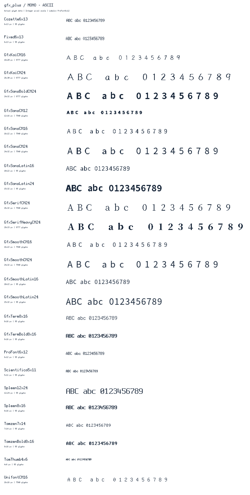
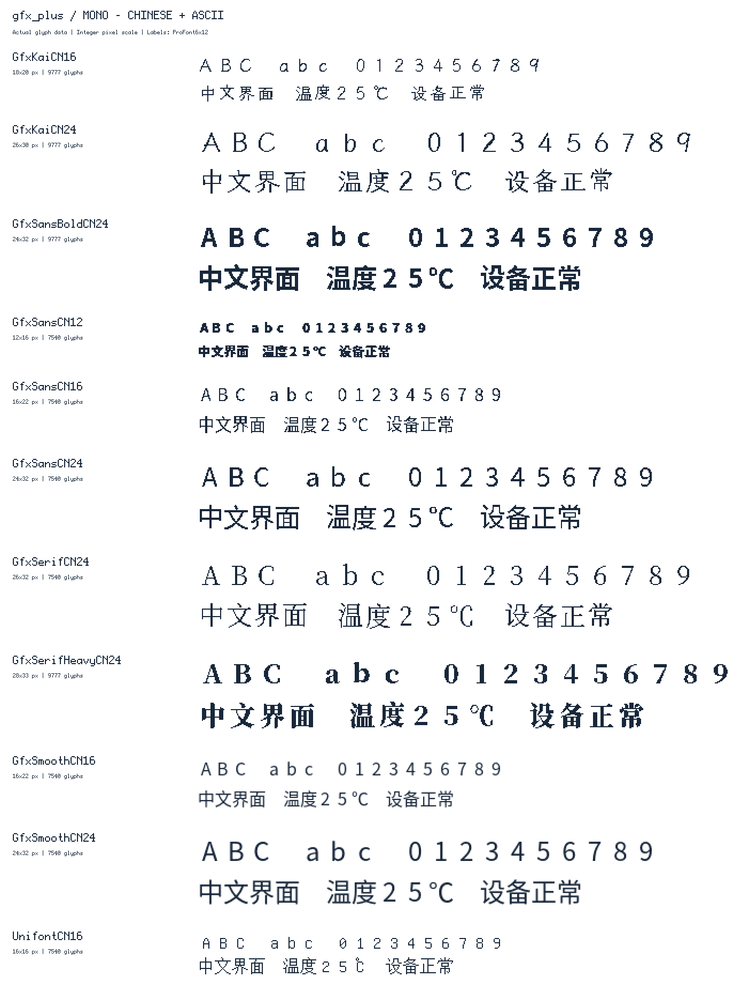

# 字体图样与调用方法

本库提供 **22 套 1bpp 点阵字体和 4 套 4bpp 平滑字体**，全部通过 MonoFont 接口选择。下方图样直接解码库内字模，放大时使用整数倍像素。完整资产清单、来源、样例文字和绘图倍率见 [图样清单](assets/fonts/previews/catalog.json)。

只需包含 `NICE_GFX.h`，绘制前调用 `gfx.setFont(nice_gfx::fonts::Fixed6x13)`。未选字体时，文字不绘制，`textWidth()` / `fontHeight()` 返回 0；屏幕与 Sprite 可以各自选择字体，无需启用宏或额外字体头。

使用 `drawString(text, x, y)`、`drawNumber(value, x, y)`、`drawFloat(value, decimals, x, y)` 和 `drawChar(Unicode, x, y)`。文字颜色、背景、整数倍率和对齐方式分别由 `setTextColor()`、`setTextSize()`、`setTextDatum()` 设置。

## 抗锯齿默认开启

编辑器的字体与图标面板都提供默认勾选的“抗锯齿”，适用于所有内置字体、现有字号和 1–128px 图标。取消勾选会恢复清晰的二值像素边缘。对应样式为 `antialiasing: auto` / `none`；它会继承到未单独覆盖的子组件，并随项目、撤销和固件导出保存。

原生库也默认开启，可通过 `gfx.setAntialiasing(false)` 关闭，`gfx.getAntialiasing()` 查询。字体与 `drawIcon()` 共用此设置；1bpp 字模平滑处理角部并保留孤立像素、细直笔画，4bpp 字模保留原生灰度，在放大和回退缩放时插值。字号仍按所选字体的 1–7 倍计算，抗锯齿不改变字符格、前进宽度或排版尺寸。

直接绘制到不能读回背景的屏幕时，指定文字背景色；图标使用 `gfx.drawIcon(x, y, icon, foreground, background, 1)`。透明抗锯齿需要可读背景或 Sprite；完整灰度效果推荐 16bpp Sprite。

## 平滑字体：16 级灰度抗锯齿

普通中文界面推荐 `GfxSmoothCN16` / `GfxSmoothCN24`，英文数据界面可选 `GfxSmoothLatin16` / `GfxSmoothLatin24`。字模由思源黑体轮廓直接生成灰度覆盖率，编辑器、字体样本和固件使用同一份数据。优先使用原生 16px / 24px；`setTextSize()` 仍是整数倍放大，无法补回小字模缺少的细节。

| 字体对象 | 原生字号 / 字符格 | 字模及索引字节 | 覆盖范围 |
| --- | --- | ---: | --- |
| `GfxSmoothCN16` | 16px / 16×22 | 1,342,120 | GB2312 + ASCII，共 7,540 字形 |
| `GfxSmoothCN24` | 24px / 24×32 | 2,910,440 | 同上 |
| `GfxSmoothLatin16` | 16px / 10×22 | 10,450 | ASCII 95 字符 |
| `GfxSmoothLatin24` | 24px / 15×32 | 24,320 | ASCII 95 字符 |

编辑器中选择“GfxSmooth 平滑黑体”，将字号设为对应的 16px 或 24px，为一行文字预留至少 22px 或 32px 高度。中文全量灰度字库较大，固定文案建议在“中文字体与空间优化”中选择“仅项目文字”，并补充运行时会出现的文字；导出子集保留灰度数据和原始许可。

```cpp
gfx.setFont(nice_gfx::fonts::GfxSmoothCN16);
gfx.setTextSize(1);
gfx.setTextColor(GFX_WHITE, GFX_BLACK);
gfx.drawString("温度 25", 8, 8);
```

灰度边缘与指定背景或 Sprite / HTML UI 的实际背景混合。1bpp / 4bpp Sprite 使用二值轮廓，保留位值与调色板索引；8bpp Sprite 会量化灰度颜色。

`MonoFont` 描述符的尾部字段 `bitsPerPixel` 为 `4` 时表示逐行字节对齐、每字节高半字节在左的灰度覆盖率；省略或为 `0` / `1` 时保持原有 1bpp 格式。编辑器字模资源以 `GFX4` 标记灰度格式，原有 `GFXF` 文件仍然有效。

## 22 套 1bpp 点阵字体

以下字体都是 **1bpp 点阵**。英文 13 套各含 95 个可打印 ASCII 字符，即 U+0020～U+007E；不包含中文、重音字母或完整 Unicode。下表尺寸是实际字符格，`fontHeight()` 在 `setTextSize(1)` 时返回其高度。



| 对象名（`nice_gfx::fonts::`） | 字符格 | 单独图样 |
| --- | --- | --- |
| `TomThumb4x6` | 4×6 | [查看](assets/fonts/previews/mono/TomThumb4x6.png) |
| `Scientifica5x11` | 5×11 | [查看](assets/fonts/previews/mono/Scientifica5x11.png) |
| `ProFont6x12` | 6×12 | [查看](assets/fonts/previews/mono/ProFont6x12.png) |
| `Fixed6x13` | 6×13 | [查看](assets/fonts/previews/mono/Fixed6x13.png) |
| `Cozette6x13` | 6×13 | [查看](assets/fonts/previews/mono/Cozette6x13.png) |
| `Tamzen7x14` | 7×14 | [查看](assets/fonts/previews/mono/Tamzen7x14.png) |
| `Spleen8x16` | 8×16 | [查看](assets/fonts/previews/mono/Spleen8x16.png) |
| `GfxTerm8x16` | 8×16 | [查看](assets/fonts/previews/mono/GfxTerm8x16.png) |
| `GfxTermBold8x16` | 8×16 | [查看](assets/fonts/previews/mono/GfxTermBold8x16.png) |
| `GfxSansLatin16` | 10×22 | [查看](assets/fonts/previews/mono/GfxSansLatin16.png) |
| `GfxSansLatin24` | 15×32 | [查看](assets/fonts/previews/mono/GfxSansLatin24.png) |
| `Spleen12x24` | 12×24 | [查看](assets/fonts/previews/mono/Spleen12x24.png) |
| `TamzenBold8x16` | 8×16 | [查看](assets/fonts/previews/mono/TamzenBold8x16.png) |



| 对象名（`nice_gfx::fonts::`） | 字符格 | 实际字符覆盖 | 单独图样 |
| --- | --- | --- | --- |
| `UnifontCN16` | 16×16 | 7,540 字形：GB2312 7,445 字符 + ASCII 95；其中汉字 6,763 个 | [查看](assets/fonts/previews/mono/UnifontCN16.png) |
| `GfxSansCN12` | 12×16 | 同上 | [查看](assets/fonts/previews/mono/GfxSansCN12.png) |
| `GfxSansCN16` | 16×22 | 同上 | [查看](assets/fonts/previews/mono/GfxSansCN16.png) |
| `GfxSansCN24` | 24×32 | 同上 | [查看](assets/fonts/previews/mono/GfxSansCN24.png) |
| `GfxSerifCN24` | 26×32 | 同上 | [查看](assets/fonts/previews/mono/GfxSerifCN24.png) |
| `GfxKaiCN16` | 18×20 | 9,777 字形：9,000 汉字 + GB2312 非汉字 + ASCII | [查看](assets/fonts/previews/mono/GfxKaiCN16.png) |
| `GfxKaiCN24` | 26×30 | 同上 | [查看](assets/fonts/previews/mono/GfxKaiCN24.png) |
| `GfxSansBoldCN24` | 24×32 | 同上 | [查看](assets/fonts/previews/mono/GfxSansBoldCN24.png) |
| `GfxSerifHeavyCN24` | 28×33 | 同上 | [查看](assets/fonts/previews/mono/GfxSerifHeavyCN24.png) |

中文字体也包含 ASCII，但字形居中到同一个全宽字符格。名称中的 16 / 24 是源字体栅格化字号；实际行高如表。GB2312 表示字形覆盖范围，**输入字符串仍用 UTF-8**，不是 GB2312 编码。9000 汉字集合也不等于所有中日韩统一表意文字；缺字使用 `?`，完整四字节 UTF-8 字符也会显示一个替代字符。

完整中文字体仅在非 AVR 平台声明，占约 250～1,280 KiB Flash；AVR 使用生成的短文本子集，并检查 near-PROGMEM 地址范围。现代字模各自独立定义，不引用的字库可由链接器裁剪。不要为了遍历所有字体而在正式固件里建立全量指针表。

以下是完整的 Arduino 示例。显示型号和引脚按实际硬件修改；中文部分在 AVR 上自动跳过。

```cpp
#include <NICE_GFX.h>

ILI9341_240x320_SPI gfx(5, 2, 4, 18, 23, 19);

void setup() {
  if (!gfx.begin()) return;
  gfx.fillScreen(GFX_BLACK);
  gfx.setTextColor(GFX_WHITE, GFX_BLACK);
  gfx.setTextSize(1);
  gfx.setFont(nice_gfx::fonts::Fixed6x13);
  gfx.drawString("Ready 123", 8, 8);
#if !defined(__AVR__)
  gfx.setFont(nice_gfx::fonts::UnifontCN16);
  gfx.drawString("温度：25℃", 8, 32);
#endif
  gfx.setFont(nice_gfx::fonts::Spleen8x16);
  gfx.setCursor(8, 64);
  gfx.println("Line 1");
  gfx.println("Line 2");
}

void loop() {}
```

`setTextSize(1..7)` 是整数像素缩放，不是字号；`drawString()` 是单行接口，换行使用 `print()` / `println()`。`setTextDatum()` 控制字符串对齐，`setTextPadding()` 可擦除上一次较长字符串的尾部，`textWidth()` / `fontHeight()` 使用当前字体及倍率。

`getFont()` 返回当前 `MonoFont` 指针；`setFont(nullptr)` 清除对象字体，回到无字体状态。详细来源、字模占用、中文子集生成和授权见 [Fonts/README.md](../src/Fonts/README.md)、[EditorFonts.md](../src/Fonts/EditorFonts.md) 与 [ExtendedDeviceFonts.md](../src/Fonts/ExtendedDeviceFonts.md)。

## 自定义字体与中文子集

推荐从现代字体生成只含界面文字的 `MonoFont` 子集。生成结果是 `.h` / `.cpp` 和授权文件，草图包含生成的头，然后调用 `gfx.setFont(nice_gfx::fonts::ProjectCN)`。支持界面文字子集，以及扩展中文字库的 3,000 / 5,000 / 9,000 汉字预设；原 GB2312 字库只有 6,763 汉字，不能生成 9,000 汉字覆盖。生成步骤见 [字体说明](../src/Fonts/README.md) 和 [扩展字体](../src/Fonts/ExtendedDeviceFonts.md)。

也可手写 [MonoFont](../src/Fonts/Monospace.h) 描述符。每行按字节补齐、最高位在左，字形按字符索引依次存储；稀疏 Unicode 索引须升序。`codepoints == nullptr` 表示从 U+0020 开始连续 ASCII。描述符、字模和索引必须在显示使用期间一直存活。下面定义一个只有 `?` / `A` 的 5×7 字体，可加入上面的现代字体示例：

```cpp
static const uint16_t tinyCodes[] PROGMEM = {0x003F, 0x0041};
static const uint8_t tinyBitmap[] PROGMEM = {
  0x70, 0x88, 0x08, 0x10, 0x20, 0x00, 0x20,  // ?
  0x70, 0x88, 0x88, 0xF8, 0x88, 0x88, 0x88   // A
};
static const nice_gfx::MonoFont tinyFont = {
  tinyBitmap, tinyCodes, 2, 5, 7, 7, nullptr
};
// setup() 中：
// gfx.setFont(tinyFont);
// gfx.drawString("A?", 8, 8);
```

`MonoFont::fallback` 可指定一级后备字库；仅缺失字形使用后备，行高仍为主字体高度，后备字符前进宽度为主字体高度。无后备命中时尝试主字体的 `?`。后备字库也必须存活；引用完整中文字库仍会保留其全部字模。

字体来源和许可保存在 [Fonts/licenses](../src/Fonts/licenses)。分发字体子集或原始字模时保留对应授权和版权声明。

## 字体源码布局

字体声明和字模统一位于 `src/Fonts/`；26 个字库（22 套 1bpp、4 套 4bpp）的独立定义文件为 `src/Fonts/Mono/GFX_Font_<名称>.cpp`，与各自 `.inc` 数据同目录。包含 `NICE_GFX.h` 只引入声明，链接时保留实际引用的字模。

默认构建和编辑器完整导出包含这些字体编译单元。ESP-IDF 可通过 `NICE_GFX_FONT_SOURCES` 按需选择，详见 [架构说明](Architecture.md#esp-idf-构建)。

检查字体占用时，分别编译无字体、单套英文字体和单套中文字库，并核对最终 ELF 符号与 Flash 用量；具体结果取决于目标平台与链接选项。
