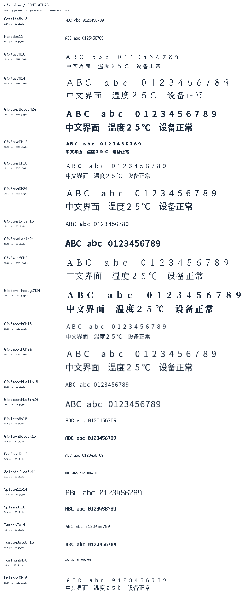

# 内置等宽点阵字体

只需 `#include <NICE_GFX.h>`，用 `setFont()` 选择字体。主头文件包含二十二套点阵字体和四套灰度平滑字体的声明，字模在各自独立的 `.cpp` 中定义一次。没有字体启用宏、全局注册表或注册构造函数；屏幕与 Sprite 各自保存所选字体的指针，多个源文件共享同一份数据。平滑字体的选择、背景混合与空间优化见 [字体调用方法](../../docs/font.md)。早期新增像素字体见 [新增字体说明](EditorFonts.md)；新增楷体、粗黑体、重宋体及更大像素字库见 [扩展设备字体](ExtendedDeviceFonts.md)，包含完整许可、源码锁定和离线生成方式。

| 字体对象（位于 `nice_gfx::fonts`） | 字符格 | 字形及索引字节 | 字符范围 |
| --- | --- | ---: | --- |
| `TomThumb4x6` | 4×6 | 570 | ASCII 95 字符 |
| `Scientifica5x11` | 5×11 | 1,045 | ASCII 95 字符 |
| `ProFont6x12` | 6×12 | 1,140 | ASCII 95 字符 |
| `Fixed6x13` | 6×13 | 1,235 | ASCII 95 字符 |
| `Cozette6x13` | 6×13 | 1,235 | ASCII 95 字符，紧凑像素风 |
| `Tamzen7x14` | 7×14 | 1,330 | ASCII 95 字符 |
| `Spleen8x16` | 8×16 | 1,520 | ASCII 95 字符 |
| `GfxTerm8x16` | 8×16 | 1,520 | ASCII 95 字符，常规终端风 |
| `GfxTermBold8x16` | 8×16 | 1,520 | ASCII 95 字符，粗体终端风 |
| `UnifontCN16` | 16×16 | 256,360 | GB2312 全部 7,445 字符 + ASCII 95 字符 |
| `GfxSansCN12` | 12×16 | 256,360 | GB2312 全部 7,445 字符 + ASCII 95 字符，小屏中文 |
| `GfxSansCN16` | 16×22 | 346,840 | 同上，思源黑体 16px 派生点阵 |
| `GfxSansCN24` | 24×32 | 738,920 | 同上，思源黑体 24px 派生点阵 |
| `GfxSerifCN24` | 26×32 | 980,200 | 同上，思源宋体 24px 派生点阵 |
| `GfxKaiCN16` | 18×20 | 606,174 | 9,000 汉字 + GB2312 非汉字 + ASCII，手写楷体 |
| `GfxKaiCN24` | 26×30 | 1,192,794 | 同上，手写楷体 24px |
| `GfxSansBoldCN24` | 24×32 | 958,146 | 同上，粗黑体 24px |
| `GfxSansLatin16` | 10×22 | 4,180 | ASCII 95 字符，紧凑无衬线 16px |
| `GfxSansLatin24` | 15×32 | 6,080 | ASCII 95 字符，紧凑粗无衬线 24px |
| `GfxSerifHeavyCN24` | 28×33 | 1,310,118 | 同上，重宋体 24px |
| `Spleen12x24` | 12×24 | 4,560 | ASCII 95 字符，大字像素风 |
| `TamzenBold8x16` | 8×16 | 1,520 | ASCII 95 字符，粗体像素风 |

英文字体包含 U+0020～U+007E。五套 GB2312 中文字体各有 7,540 个字形，其中汉字 6,763 个；新增四套扩展中文各有 9,777 个字形，其中汉字 9,000 个。输入仍是 **UTF-8**，并非 GB2312 编码。中文字体内的 ASCII 也居中放入该字体的字符格，因此空格、标点、中英文全部等宽。字符格包含留白，支持 `setTextSize(1..7)` 整数放大。

思源派生字体名称中的 12/16/24 是原始栅格化字号，实际字符格和 `fontHeight()` 如表所示。保留统一基线及上下伸笔画，宋体额外保留横向衬线空间，不将原字形硬裁为正方形。24px 更适合中文标题和正文；16px 黑体适合紧凑界面，复杂汉字建议选 24px。这些仍是 1 位点阵，并非运行时矢量或抗锯齿字体。



`GfxSansCN12` 从锁定的思源黑体轮廓字体按 12px 实际栅格化，字形保留在 12×16 字符格中，供 160×128 小屏正文使用。包含 7,540 字形、6,763 汉字，完整资源 256,360 B；导出可按界面文字取子集。原生字模和编辑器预览共用同一位图，来源哈希、OFL 声明见 [许可说明](licenses/GfxSansCN12-NOTICE.txt)。预览资源位于 `docs/assets/fonts/`，正常构建使用已提交的字模。

`GfxSansLatin16/24` 从本地思源黑体字模提取 ASCII 并调整字符格，适合英文标题、计时、百分比和读数，避免直接使用中文全宽格造成数字间距过大。它们仍是等宽 1 位点阵；中文请使用对应的 `GfxSansCN` 字体。两套完整字模共 10,260 B，不改变渲染 API 或资源 ABI。源字模哈希记录在生成文件中，使用 SIL OFL 1.1；字模来源与哈希记录在字体头文件和许可声明中。

预览按整数倍放大实际编译字模。可运行 [Additional_Fonts 示例](../../examples/Generic/Additional_Fonts/Additional_Fonts.ino)轮换查看新增字体；先修改屏幕型号和引脚。示例在非 AVR 平台引用全部六套新增字体，完整中文合计约 1.97 MiB；AVR 示例仅使用 `GfxTerm8x16`。

字体不需要文件系统、不分配字体堆内存。字模在 AVR 使用 PROGMEM，在其他平台按只读 Flash 数据存放。表中不含少量字体描述信息、每个显示对象的字体指针及绘制代码；AVR 的字体描述信息会占用少量 RAM。完整中文只在非 AVR 平台提供；AVR 请使用小子集，并确认数据位于近地址 PROGMEM 的 64 KiB 范围内。新增字体不改变已有程序的默认字体，也不修改渲染器。

## 使用

```cpp
#include <NICE_GFX.h>

ILI9341_240x320_SPI gfx(5, 2, 4, 18, 23, 19); // 按开发板修改引脚
GFX_Sprite label(&gfx);

void setup() {
  if (!gfx.begin()) return;
  gfx.setFont(nice_gfx::fonts::Fixed6x13);
  gfx.setTextColor(GFX_WHITE, GFX_BLACK);
  gfx.drawString("Hello", 8, 8);
  gfx.setCursor(8, 32);
  gfx.println("Ready");

  label.setFont(nice_gfx::fonts::TomThumb4x6); // 独立选择，共用字模
}

void loop() {}
```

只有实际引用的两套英文字体需要进入这个示例的固件。声明所有字体不会自动选择或引用它们。显示对象构造后不选择任何内置字体：默认构建中，未调用 `setFont()` 时文本宽高为 0、不绘制文字。`setFont(nullptr)` 清除对象字体；若全工程显式启用了旧字体，则恢复旧默认字体。

`setFont()` 同时接受 `const nice_gfx::MonoFont &` 和指针；`getFont()` 返回当前对象字体指针，未选择时为 `nullptr`。字体描述对象必须在使用期间保持有效，内置及生成的字体均具有静态生命周期。切换字体会重置正在接收的 UTF-8 序列。无需注册，任何 `.cpp` 都能直接选择字体。

中文示例（有足够 Flash 的非 AVR MCU）：

```cpp
gfx.setFont(nice_gfx::fonts::UnifontCN16);
gfx.drawString("温度：25℃", 8, 8);
gfx.println("设备运行正常");
```

切换新增风格的接口相同：

```cpp
gfx.setFont(nice_gfx::fonts::GfxSansCN24);
gfx.drawString("温度25℃", 8, 8);
gfx.setFont(nice_gfx::fonts::GfxSerifCN24);
gfx.drawString("设备正常", 8, 48);
gfx.setFont(nice_gfx::fonts::GfxTermBold8x16);
gfx.drawString("READY 100%", 8, 88);
```

`drawString`、`textWidth`、`fontHeight`、`drawChar(Unicode, x, y)`、`drawNumber`、`drawFloat`、`print/println` 和 Sprite 使用当前字体。支持 datum 对齐、背景填充、padding、视口裁剪、缩放及流式换行；`drawString` 是单行接口，换行使用 `print/println`。测量和绘制字符串不消耗 `print()` 正在接收的 UTF-8 字节。

缺失字形显示同格宽的 `?`。BMP 外字符（如 emoji）、非法序列按缺字处理；完整四字节序列只占一个字符格。`setAttribute(UTF8_SWITCH, 0)` 可切换为逐字节模式。

## 未用字体如何裁剪

编译器使用 `-ffunction-sections -fdata-sections`，链接器使用 `-Wl,--gc-sections`。Arduino 的已验证 AVR / ESP32 core 提供对应配置；自定义构建系统须启用等价的段裁剪。MSVC 主机测试使用 `/Gy /Gw /OPT:REF`。LTO 不是这个设计的必要条件。

所有字体实现位于 `src/Fonts/Mono/GFX_Font_*.cpp`，最终 Flash 只保留可达的字体数据。Arduino、ESP-IDF 和自包含导出都直接编译这些字体文件；`npm run check` 核对库与发布目录。手动维护源文件列表时须添加所需字体实现。全部字体图样与调用方法见 [字体指南](../../docs/font.md)。

不要创建包含所有字体地址的可达全局表、自动注册函数，或用链接脚本 `KEEP` 保留全部字库。运行时可能被菜单选中的字体属于已引用字体，即使某次运行未选择它，也需要保留。字体级裁剪不会自动删除已选字库内没用过的汉字。

## 按界面文本生成中文子集

在编辑器的字体导出设置中选择所用字形，并补充运行时可能显示的文本。导出资源会保存所需字形，无需在固件运行时加载原始字体。手动维护独立字体时，将生成的 `.h/.cpp` 随应用保存。

例如独立字体命名为 `ProjectCN.h` 和 `ProjectCN.cpp`，可放在 Arduino sketch 目录，与 `.ino` 一起编译；PlatformIO 可将二者放在 `src`。其他构建系统将生成的 `.cpp` 加入源文件列表。使用：

```cpp
#include <Graphics/Gfx.h>
#include "ProjectCN.h"

// setup() 中：
gfx.setFont(nice_gfx::fonts::ProjectCN);
```

不引用 `UnifontCN16`，完整中文字库就不会进入固件。生成器自动保留 ASCII、去重、排序；每个字符占 34 字节（32 字节点阵 + 2 字节索引）。例如 95 个 ASCII 加 14 个汉字共 3,706 字节。增加界面文字后重新生成；源字体不存在的码点会报错。不同子集可使用不同 `--name`，在同一程序中共存。

分发子集时也须保留下面的 Unifont 授权与作者说明。

黑体、宋体等其他字库也可按界面文字选择子集：

中文子集可通过编辑器的字体导出设置生成，生成字体的 `.h/.cpp` 随应用保存。

生成 `ProjectSans.h`、`ProjectSans.cpp` 和 `licenses/`，代码使用 `gfx.setFont(nice_gfx::fonts::ProjectSans)`。`--font` 可换成 `GfxSansCN16` 或 `GfxSerifCN24`。自动保留 ASCII、按 Unicode 去重排序，并复制该字体的完整许可与派生说明；发布时一起保留。字符数据分别占 46、98、130 字节/字符；例如黑体 24px 的 95 个 ASCII 加 14 个中文字符只占 10,682 字节。未覆盖的码点或会被裁切的字形会报错，避免静默生成缺字。自定义名称不能与内置对象、C++ 关键字或上游保留名称 `Source` 冲突。

正常 Arduino 编译无需 Python、Pillow、fontTools 或字体源文件。HTML/CSS 设计器可按组件选择这里的二十二套字库，支持继承，并以相同字模预览。例如 `font-family:GfxSansCN24; font-size:24px` 会生成对应字体引用到 `ui.h`；主程序无需另行选择字体。设计器字号使用所选原生字号的 1～7 倍，其他字号有量化提示。完整 Arduino ZIP 保留全部字库源码和许可证，便于后续只替换 `ui.h` 更换字体；未被引用的字模不会进入最终固件。

## 来源、授权及重现

二十二套均可免费用于商业产品，分发时保留对应字体的版权及许可文件。OFL 字体及派生字模维持 OFL 1.1 许可，不单独出售字体；字体许可不要求使用它的应用程序改用 OFL。新增派生名称避开上游保留名称。新增四套扩展中文及两套像素字体的具体来源、字数、许可证和生成命令见 [扩展设备字体](ExtendedDeviceFonts.md)。其余来源如下：

- Tom Thumb：Brian J. Swetland、Vassilii Khachaturov 原始小字体，Robey Pointer 改进；保留 [BSD 原始声明](licenses/TomThumb.txt)。[作者说明](https://robey.lag.net/2010/01/23/tiny-monospace-font.html)还提供 MIT / CC0 / CC-BY 3.0 授权。
- ProFont：Carl Osterwald、Stephen C. Gilardi、Andrew Welch，[MIT 许可](licenses/ProFont-MIT.txt)，[上游来源和授权](https://github.com/olikraus/u8g2/wiki/fntgrpprofont)。
- X11 Misc Fixed 6×13：源 BDF 声明为 [Public Domain](licenses/Fixed-Public-Domain.txt)，[来源说明](https://github.com/olikraus/u8g2/wiki/fntgrpx11)。
- GNU Unifont 16.0.04：本库选择字体的 [SIL OFL 1.1 授权](licenses/Unifont-OFL-1.1.txt)，保留 [上游授权说明](licenses/Unifont-COPYING)及 [作者声明](licenses/Unifont-AUTHORS)。[固定版本发行包](https://unifoundry.com/pub/unifont/unifont-16.0.04/)中的字形经本库裁剪、格式转换，半宽字符居中到全宽格。
- Cozette v.1.30.0：Ines，[MIT 许可](licenses/Cozette-MIT.txt)，[官方版本](https://github.com/the-moonwitch/Cozette/releases/tag/v.1.30.0)。保留 ASCII 字形，`4`/`q` 各向左平移 1px，以保留越出 advance 的笔画。
- GfxTerm 常规/粗体：派生自 Dimitar Toshkov Zhekov 的 Terminus 4.49.1，[SIL OFL 1.1 许可](licenses/Terminus-OFL-1.1.txt)，[官方网站](https://terminus-font.sourceforge.net/)。ASCII 裁剪与格式转换，使用新的派生名称。
- GfxSansCN16/24：派生自 Adobe Source Han Sans CN Regular 2.005R，[完整 OFL 1.1 许可和版权](licenses/SourceHanSans-OFL-1.1.txt)，[官方固定版本](https://github.com/adobe-fonts/source-han-sans/tree/6c709ca72d3d7c46ab42ebecc1a26e7d69595a37)。转换为 1bpp 等宽单元格并裁剪字符集。
- GfxSerifCN24：派生自 Adobe Source Han Serif CN Regular 2.003R，[完整 OFL 1.1 许可和版权](licenses/SourceHanSerif-OFL-1.1.txt)，[官方固定版本](https://github.com/adobe-fonts/source-han-serif/tree/7889f11bf31170b5d092a083b357c8c8130f89e0)。转换方式同上，保留衬线。

字模的来源、版权和固定版本记录在各字体头文件及 [许可目录](licenses) 中。预览图和目录数据位于 [字体文档资源](../../docs/assets/fonts)。正常编译不下载字体，也不依赖原始 BDF/OTF 或字体生成工具。需要更新字模时，应一并更新源码、来源记录、预览与编辑器字体资源。

## 从旧字体接口迁移

字体统一由 `setFont()` 选择，不再提供数字编号、FreeFont 或 VLW 加载接口。删除旧 `LOAD_*` / `SMOOTH_FONT` 和入口字体宏配置，使用独立的 MonoFont 对象或生成项目子集。常用替换为：

| 原用途 | 对象选择 |
| --- | --- |
| 小字号 ASCII | `setFont(nice_gfx::fonts::TomThumb4x6)` 或 `ProFont6x12` |
| 常规文本 | `setFont(nice_gfx::fonts::Fixed6x13)` 或 `GfxSansLatin16` |
| 大数字和标题 | `setFont(nice_gfx::fonts::Spleen12x24)`，按需设置整数倍率 |
| 中文界面 | `setFont(nice_gfx::fonts::GfxSansCN12)`、`GfxSansCN16` 或生成所需字形子集 |

`drawString/drawNumber/drawFloat` 使用当前对象字体，不再传字体编号。单字绘制使用 `drawChar(codepoint, x, y)`，其颜色、背景和倍率由对象文本设置决定。字体切换后重新测量文本宽度和行高，避免沿用旧比例字库的基线和布局常量。`getFont()` 返回当前字体指针，`setFont(nullptr)` 清除该对象的字体选择。
